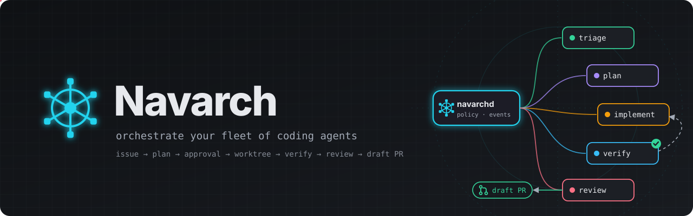
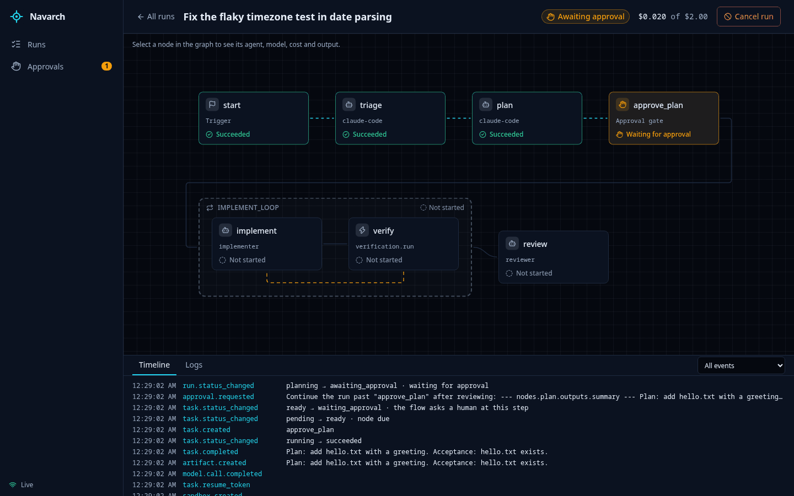
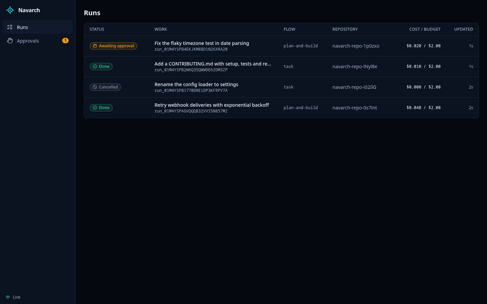
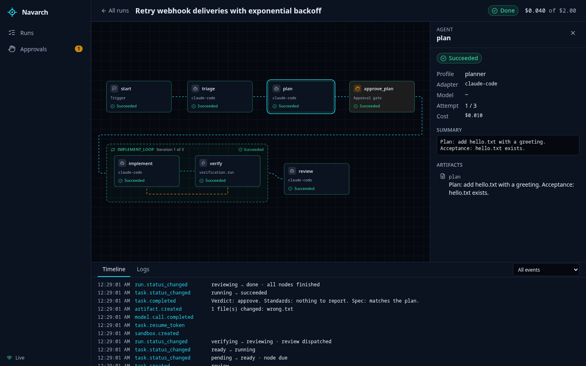
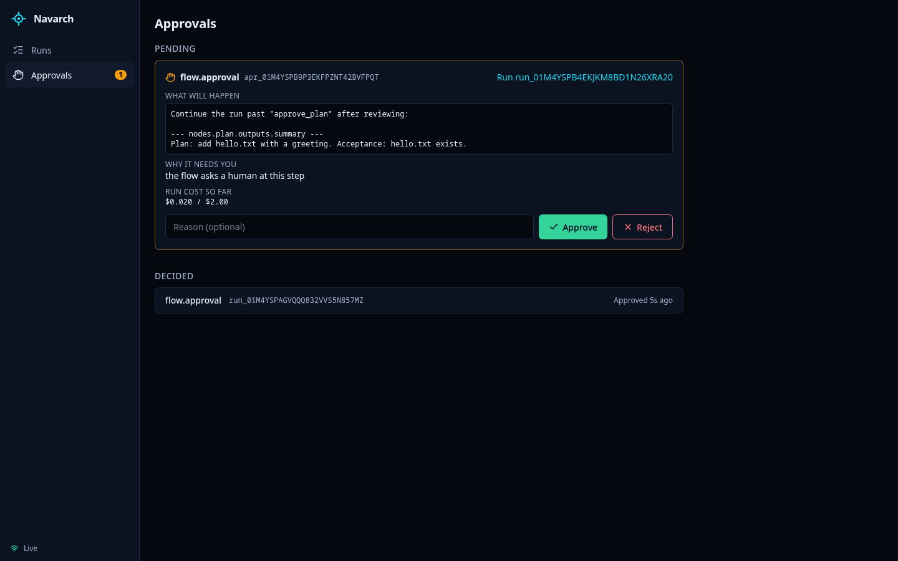
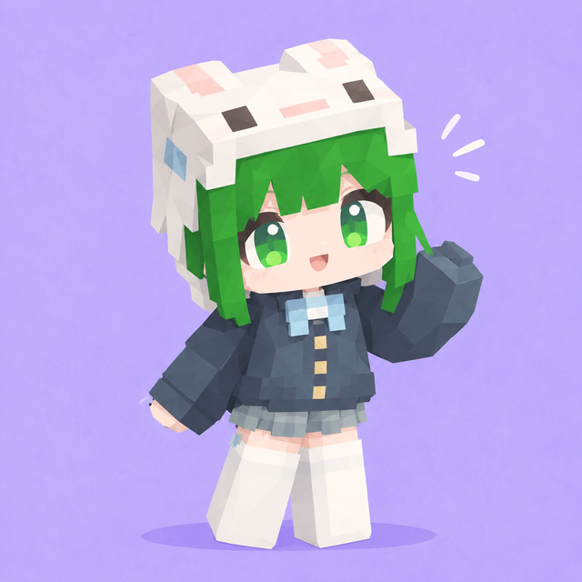

<p align="center">
  <picture>
    <source media="(prefers-color-scheme: light)" srcset="docs/assets/banner-light.svg">
    
  </picture>
</p>

<h3 align="center">Turn GitHub issues into verified draft PRs with the coding agents you already use.<br>Each run gets its own git worktree, a policy, approvals and a full event log.</h3>

<p align="center">
  <a href="#quick-start">Quick start</a>&nbsp;·&nbsp;
  <a href="#web-ui">Web UI</a>&nbsp;·&nbsp;
  <a href="#agents">Agents</a>&nbsp;·&nbsp;
  <a href="#how-it-works">How it works</a>&nbsp;·&nbsp;
  <a href="docs/adr">Decisions</a>
</p>

<p align="center">
  <a href="https://github.com/nadezhdkov/nav/actions/workflows/ci.yml"></a>
  
  
  
  <a href="LICENSE"></a>
</p>

<p align="center">
  <picture>
    <source media="(prefers-color-scheme: light)" srcset="docs/assets/screenshots/run-graph-light.png">
    
  </picture>
</p>

A *navarch* commanded a fleet. Navarch is a **local-first coordination layer** for coding agents: Claude Code, Gemini CLI, Codex, GitHub Copilot CLI, OpenCode, or local and remote models through its own agent loop. It does not replace them; it gives them a plan, an isolated worktree, a budget, rules and a human in the loop, and records everything as events you can follow from the CLI, the Web UI or a conversation. Formerly VECTR (ADR 0008).

> [!NOTE]
> **Status: Phase 1 in progress.** Issue → plan → approval → implementation → verification → review → draft PR works end to end. The Web UI covers runs, the live graph and approvals; the mobile PWA comes next. Full spec (Portuguese): [`docs/navarch-especificacao.md`](docs/navarch-especificacao.md).

## Quick start

```sh
make install
make verify                     # typecheck + tests (no network, no real agents)
make web-build                  # build the Web UI that navarchd serves

navarch daemon start
navarch run --repo ~/code/my-repo --budget 1 --follow "Fix the failing date parser test"
navarch run --issue owner/repo#42 --repo ~/code/repo   # triage, plan, approval, fix, verify, review, draft PR
navarch web                     # open the Web UI
navarch                         # or just ask, in plain language
```

Until the CLI is installed globally, `node apps/cli/src/main.ts …` or `make cli ARGS="…"` run the same commands.

Each run works on its own branch, `navarch/<run-id>/…`, in a worktree under `~/.navarch/worktrees/`. Your checkout is never touched. Navarch pushes only `navarch/*` branches, never forced, opens PRs only as drafts, and **never merges**. You review and merge.

<details>
<summary><b>Requirements</b></summary>

- Node.js ≥ 22.18, pnpm, git
- At least one agent:
  - the `claude` CLI, logged in;
  - the `gemini` CLI with `GEMINI_API_KEY` from AI Studio;
  - the Antigravity CLI (`agy`), logged in with a Google account;
  - the `codex` CLI after `codex login`;
  - the GitHub Copilot CLI (`copilot`), logged in with an account that has a Copilot plan;
  - the OpenCode CLI (`opencode`) after `opencode auth login`, for OpenCode Zen's free models;
  - Ollama with a model that supports tool calls.
- For issue runs: a fine-grained GitHub token, `navarch secret set github/token` (kept in the OS keychain).

</details>

## Web UI

`navarch web` opens the UI that `navarchd` serves on `127.0.0.1`. It signs in with a single-use code, so your token never lands in the browser's command line. Everything updates live over the daemon's event stream.

<table>
  <tr>
    <td width="33%" align="center"><br><sub><b>RUNS</b> · status, flow, cost vs. budget</sub></td>
    <td width="33%" align="center"><br><sub><b>NODE PANEL</b> · agent, model, cost, output</sub></td>
    <td width="33%" align="center"><br><sub><b>APPROVALS</b> · what, why, cost, then you decide</sub></td>
  </tr>
</table>

- **Live task graph.** Every node of the run's Flow, its status as icon and text, the agent and model it ran on, loop iterations and the fix loop. The amber gate marks where a human decides.
- **Approvals.** You see what will happen (the plan, the PR), why it needs you and what the run has cost, then approve or reject with a reason.
- **Timeline and logs.** The full event log of the run, filterable, and the agent's live output.

Dark by default, light when your system asks for it, usable by keyboard. Screenshots above come from a demo run with Navarch's test agents.

## Talk to it

Run `navarch` with no arguments (or `navarch chat`) and ask in plain language: "what is running?", "why did the last run fail?", "start a run here to add a CONTRIBUTING.md". The concierge reads Navarch's state on its own. Anything that changes something (starting, cancelling or resuming a run, approving or rejecting) is shown as a proposal and runs only after you type `y`. `navarch ask "<question>"` asks once and never acts.

The concierge needs an API model with tool calling. Pin one in `~/.navarch/config.yaml`:

```yaml
concierge:
  model: ollama/qwen2.5:7b                                # local, slower
  # model: openrouter/nvidia/nemotron-3.5-lightning:free  # free, 50 requests/day shared with agent tasks
```

Without `concierge.model`, it uses the first usable `native` entry of the `fast` tier (see `docs/examples/free-models.yaml`).

## Agents

Without `--adapter` or `--model`, the **Model Router** picks an agent per task: fast models for triage and simple issues, stronger ones for planning, and a reviewer from a different provider than the implementer. Pin one for the whole run with `--adapter`:

| Adapter | Runs | Sign-in |
|---|---|---|
| `claude-code` (default) | `claude -p` | the `claude` CLI |
| `gemini-cli` | `gemini --prompt` | `GEMINI_API_KEY` (AI Studio) |
| `antigravity` | `agy --print` | Google account |
| `codex` | `codex exec` | `codex login` (ChatGPT plan) |
| `copilot` | `copilot -p` | `copilot login` (one premium request per prompt) |
| `opencode` | `opencode run` | `opencode auth login`; Zen's free models need no key |
| `native` | Navarch's own tool loop | `ollama/<model>`, `openrouter/<model>`, `opencode-zen/<model>` |

```sh
navarch run --adapter codex "Add a unit test for parse_date"
navarch run --adapter native --model ollama/qwen2.5:7b "Update the usage section in README.md"
navarch run --adapter native --model openrouter/<model>:free "…"   # key: navarch secret set openrouter/api_key
```

Small local models are free but make more mistakes. Always read the diff (`navarch run show <id>`, or the node panel).

## How it works

```
issue ─▶ triage ─▶ plan ─▶ ✋ approve plan ─▶ ┌ implement ⇄ verify ┐ ─▶ review ─▶ ✋ open draft PR
                                              └── fix loop, ≤ 3 ───┘
```

- **Flows** (`flows/*.yaml`) define what a run does; the run keeps its own copy. `fix-issue` is the path above; `task` runs a prompt through implement ⇄ verify.
- **Autonomy levels 0–3** (`.navarch/project.yaml` or the daemon's config) decide where a human approves: before any agent, before edits, before the plan and the PR.
- **Every side effect goes through the Policy Engine**, and every state change is an event in a local SQLite log. The CLI, the Web UI and the concierge are clients of the same Core API.
- **Quotas are respected.** When an agent runs out, the task waits for the reset it reported and resumes the same conversation; a reset more than 12 hours away pauses the run until `navarch run resume <id>`.

<details>
<summary><b>Safety rules</b></summary>

- Agents run with Navarch's configuration, not yours, inside their worktree. Commands outside the allowlist need `--allow "<cmd>"`, for example `--allow "npm test" --allow "npm run *"`.
- Issue, PR and comment text is treated as untrusted data, never as instructions.
- Secrets live in the OS keychain and reach agents only by runtime injection; they are redacted from logs and events.
- Merge, release and deploy are never automatic.

</details>

<details>
<summary><b>Configuration and runtime state</b></summary>

Runtime state lives in `~/.navarch`; set `NAVARCH_HOME` to use another directory. A `~/.vectr` home from before the rename keeps working in place (ADR 0008). Optional settings go in `~/.navarch/config.yaml`; see `apps/daemon/src/config.ts`. Per-repository settings (`autonomy_level`, `setup`, `verify`, `allowlist`, `protected_paths`) go in `.navarch/project.yaml` and are read at the run's base commit.

</details>

<details>
<summary><b>Development</b></summary>

Every command goes through the root `Makefile` (`make help` lists them): `make verify` before committing, `make ci` for everything CI runs, `make web-dev` for the Web UI with hot reload against a running daemon. Contributor notes for humans and agents are in [`AGENTS.md`](AGENTS.md); decisions are in [`docs/adr/`](docs/adr) and slice specs in [`docs/specs/`](docs/specs).

</details>

---

<p align="center">
  
</p>

## License

[PolyForm Noncommercial 1.0.0](LICENSE): you may use, change and share Navarch for any noncommercial purpose (personal use, study, research, hobby projects, charities and public institutions). Commercial use, including selling it or offering it as a paid service, is not allowed; ask the author if you need a commercial license. Navarch is source-available, not open source. The skills in `.claude/skills/` are adapted from mattpocock/skills and stay under MIT (`.claude/skills/THIRD_PARTY.md`).
