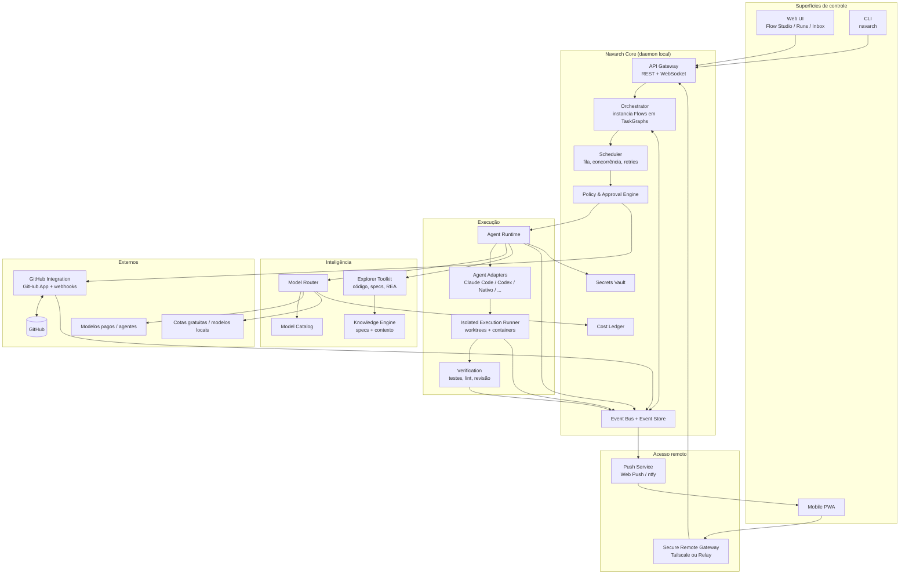
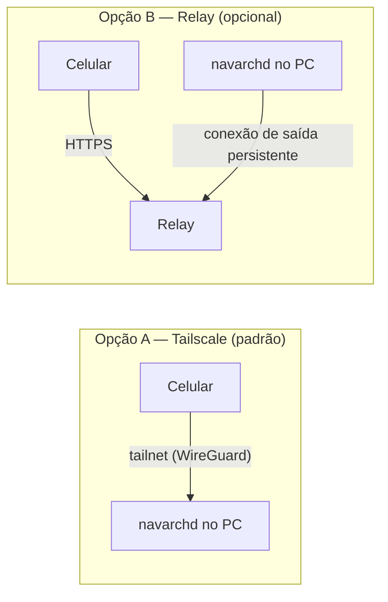
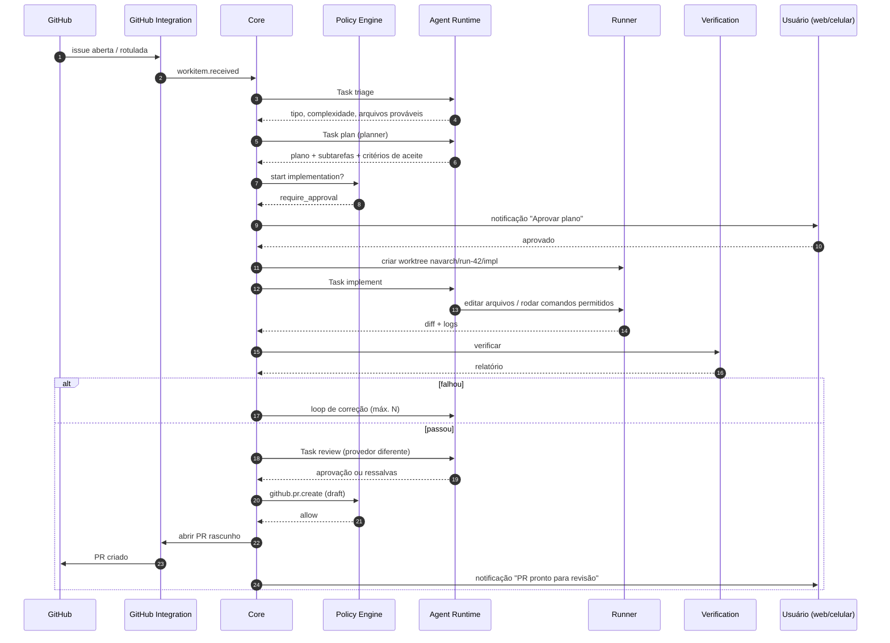
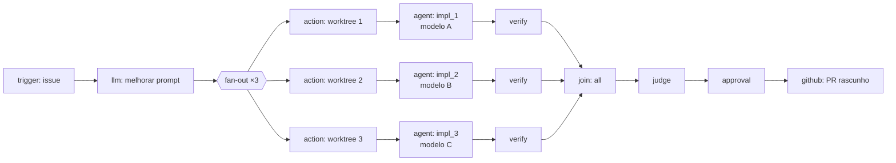
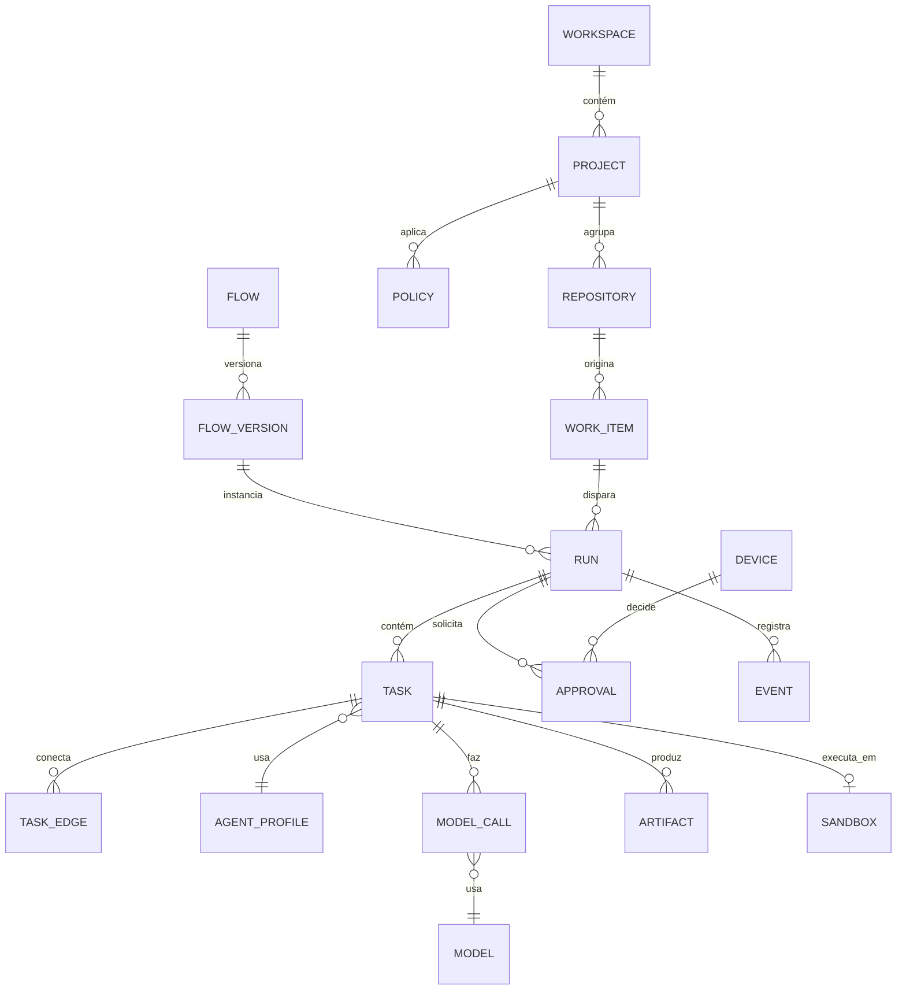
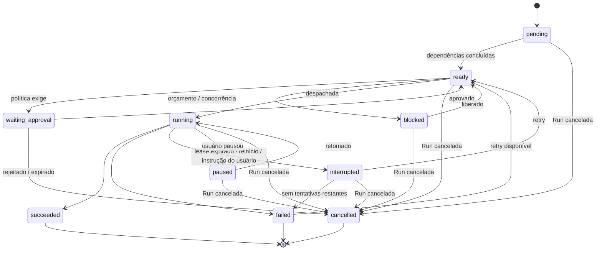

# Navarch — Plataforma de Engenharia de Software Autônoma

> **Documento de Visão, Produto e Arquitetura**
> Centro de comando para desenvolvimento com agentes de IA: orquestração visual, integração com GitHub, roteamento de modelos e controle remoto pelo celular.

| Campo | Valor |
|---|---|
| Nome do projeto | **Navarch** (antes VECTR; ver [§19.1](#191-nome-do-produto) e ADR 0008) |
| Versão do documento | 0.17 (codinome da Run em §4, ADR 0027). 0.16 (listagem e clone de repositórios do GitHub em §6.7.4, ADR 0026). 0.15 (retomada de Run `failed` em §8.4, ADR 0025). 0.14 (tela Fleet e instruções a uma Run: §15.1, motivo `instruction` em §8.3, eventos `run.message`/`run.message.delivered` em §9.2, ADR 0019). 0.13 (licença MIT de novo no lugar da PolyForm Noncommercial, §19.9, ADR 0018). 0.12 (Model Router v1 da Fase 1: nota em §6.4.3, evento `model.routed`, ADR 0013). 0.11 (Flow engine da Fase 1: §8.4 loop de correção, nota em §9.4, ADR 0011). 0.10 (licença PolyForm Noncommercial no lugar da MIT, §19.9, ADR 0010). 0.9 (licença MIT, §19.9, ADR 0009; nome conferido em registros de marca, §19.1). 0.8 (nome do produto: VECTR → Navarch, §19.1, ADR 0008). 0.7 (`setup` da worktree em §14.2, eventos `sandbox.setup` e `quota.observed` em §9.2, configuração própria dos agentes em T1; ADR 0006). 0.6: regras de trabalho dos perfis em §6.3.3, arquivos de instrução do repositório-alvo em T1, §10.2. 0.5: decisões da Fase 0 (§19.2, §19.4), cancelamento em §8.3, eventos em §9.2 |
| Status | Rascunho para análise |
| Data | Outubro de 2026 |
| Autor | Nestif |
| Público | Autor, futuros colaboradores, agentes de IA que irão implementar o sistema |

---

## Sumário

1. [Visão geral](#1-visão-geral)
2. [Revisão da proposta original](#2-revisão-da-proposta-original)
3. [Personas e casos de uso](#3-personas-e-casos-de-uso)
4. [Glossário e conceitos centrais](#4-glossário-e-conceitos-centrais)
5. [Arquitetura](#5-arquitetura)
6. [Módulos em detalhe](#6-módulos-em-detalhe)
7. [Fluxos principais](#7-fluxos-principais)
8. [Modelo de dados](#8-modelo-de-dados)
9. [Contratos e interfaces](#9-contratos-e-interfaces)
10. [Segurança e modelo de ameaças](#10-segurança-e-modelo-de-ameaças)
11. [Níveis de autonomia e aprovações](#11-níveis-de-autonomia-e-aprovações)
12. [Stack tecnológica recomendada](#12-stack-tecnológica-recomendada)
13. [Estrutura de repositório](#13-estrutura-de-repositório)
14. [Configuração](#14-configuração)
15. [Interface: telas e interações](#15-interface-telas-e-interações)
16. [Roadmap em fases](#16-roadmap-em-fases)
17. [Métricas de sucesso](#17-métricas-de-sucesso)
18. [Riscos e mitigações](#18-riscos-e-mitigações)
19. [Decisões em aberto](#19-decisões-em-aberto)
20. [Sugestões e extensões futuras](#20-sugestões-e-extensões-futuras)
21. [Referências](#21-referências)

---

## 1. Visão geral

### 1.1 Problema

Agentes de programação (Claude Code, Codex, Gemini CLI, Aider, etc.) já conseguem implementar funcionalidades, corrigir bugs e escrever testes. O gargalo deixou de ser *escrever código* e passou a ser **coordenar o trabalho**:

- Descobrir **o que** precisa ser feito espalhado por vários repositórios (issues, PRs parados, CI quebrado).
- Dividir tarefas grandes em partes paralelizáveis sem que agentes pisem uns nos outros.
- Escolher **qual modelo** usar em cada etapa, equilibrando custo, qualidade e disponibilidade.
- Acompanhar execuções longas sem ficar preso ao computador.
- Confiar no resultado: saber o que foi alterado, por quê, com qual evidência e a que custo.

### 1.2 Proposta

O Navarch é uma **camada de coordenação local** que roda no computador do desenvolvedor e:

1. Reúne trabalho de várias fontes (GitHub primeiro) em uma central única.
2. Transforma cada item de trabalho em um **grafo de tarefas** executado por agentes especializados.
3. Escolhe o modelo adequado para cada tarefa por meio de um **roteador de modelos** com políticas.
4. Executa tudo em **ambientes isolados** (worktrees e, opcionalmente, containers).
5. **Verifica** o resultado (testes, lint, revisão por outro modelo) antes de propor um PR.
6. Permite **acompanhar e aprovar** tudo pela web local ou pelo celular, de qualquer lugar.

> O Navarch **não substitui** Claude Code ou outros agentes. Ele os **orquestra**, da mesma forma que um CI orquestra compiladores sem substituí-los.

### 1.3 Princípios de projeto

| # | Princípio | Consequência prática |
|---|---|---|
| P1 | **Local-first** | Código, segredos e execução ficam na máquina do usuário. Nuvem é opcional e apenas para relay/notificação. |
| P2 | **Núcleo único, várias superfícies** | CLI, Web UI, mobile e GitHub são clientes da mesma API do Core. Nenhuma lógica de negócio vive na UI. |
| P3 | **Humano no controle do irreversível** | Push em branch protegida, release, deploy, exclusão e gastos acima do orçamento sempre exigem aprovação explícita. Merge exige aprovação por padrão; só dispensa-a se o usuário habilitar o [auto-merge opcional](#111-auto-merge-opcional) no repositório. |
| P4 | **Evidência acima de afirmação** | Toda conclusão de agente vem com evidência rastreável (arquivo/linha, saída de teste, diff). Afirmações sem evidência são marcadas como inferência. |
| P5 | **Tudo é evento** | O estado é derivado de um log de eventos append-only. Isso dá auditoria, replay, retomada após falha e streaming ao vivo de graça. |
| P6 | **Módulos substituíveis** | Adaptadores de agente, provedores de modelo, runners e fontes de trabalho são plugins com contratos explícitos. |
| P7 | **Desenvolvimento em fases com critérios de saída** | Cada fase tem um critério go/no-go mensurável antes de avançar. |
| P8 | **Conteúdo externo é não confiável** | Texto de issues, PRs, comentários e páginas web é dado, nunca instrução. |

### 1.4 Não-objetivos (pelo menos até a v1)

- Não é um serviço SaaS multi-tenant. É uma ferramenta pessoal/de pequeno time.
- Não é uma IDE. Edição manual de código continua no editor do usuário.
- Não faz deploy em produção.
- Não faz merge automático por padrão. O auto-merge é um recurso **opt-in, por repositório**, desligado de fábrica e que só o usuário pode habilitar ([§11.1](#111-auto-merge-opcional)); nunca atua em branches protegidas.
- Não tenta "contornar" limites de uso ou termos de serviço de provedores de modelos.
- O app mobile não replica a experiência desktop completa.

---

## 2. Revisão da proposta original

Esta seção registra o que foi ajustado em relação ao esboço inicial e por quê.

### 2.1 Correções estruturais

| # | Ponto original | Problema identificado | Ajuste |
|---|---|---|---|
| C1 | `TaskGraph → Isolated Execution Runner` conectado diretamente (seta lateral no diagrama) | Cria um segundo caminho de controle que ignora o Core, as políticas e o log de eventos. | Toda execução passa pelo **Scheduler do Core**, que consulta a **Policy Engine** antes de despachar para o Runner. |
| C2 | `Runner → Tests → GitHub` em cadeia | Sugere que o resultado dos testes é enviado direto ao GitHub, sem portão de aprovação. | Runner e Verification **reportam ao Core**. Apenas o **GitHub Integration** fala com o GitHub, e somente após a política permitir. |
| C3 | `Flow Studio / AutoFlow` e `TaskGraph` como módulos paralelos | Sobreposição de responsabilidade não definida. | **Flow** = definição (o "programa", versionado em YAML). **TaskGraph** = instância em execução (o "processo"). Flow Studio edita Flows; o Core instancia TaskGraphs. |
| C4 | `Model Router` chamado por Flow Studio, Explorer e TaskGraph | Componentes de UI/definição não deveriam chamar modelos. | Somente o **Agent Runtime** chama o Model Router. Explorer é exposto como um conjunto de **ferramentas** que agentes usam. |
| C5 | Ausência de camada de agentes | Faltava o componente que efetivamente executa Claude Code, Codex, etc. | Novo módulo **Agent Runtime** com **adaptadores** por tipo de agente. |
| C6 | Ausência de políticas, segredos, custos e observabilidade | São transversais e críticos para autonomia segura. | Novos módulos: **Policy & Approval Engine**, **Secrets Vault**, **Cost Ledger**, **Observability**. |
| C7 | O diagrama Mermaid da proposta original estava quebrado (CSS exportado em vez do código-fonte) | Não renderiza. | Diagramas refeitos em Mermaid válido neste documento. |

### 2.2 Refinamentos conceituais

| # | Ponto original | Refinamento |
|---|---|---|
| R1 | Perfis fixos *Fast / Standard / Expert* | Mantidos como **rótulos de conveniência**, mas o roteamento real é por **requisitos da tarefa** (capacidades, contexto, custo máximo, latência) cruzados com o **catálogo de modelos**. Assim um modelo novo entra no catálogo e passa a ser usado sem mudar Flows. |
| R2 | "Modelos gratuitos" | Tratados como **um tipo de orçamento**, não uma categoria especial: custo zero, mas com cotas, latência e confiabilidade variáveis. O roteador sempre tem fallback e nunca depende de cota gratuita para tarefas críticas. |
| R3 | "Autônoma: identifica problemas e executa" | Autonomia passa a ser **configurável por repositório e por tipo de ação**, em 5 níveis ([§11](#11-níveis-de-autonomia-e-aprovações)). |
| R4 | GitHub como "centro de entrada" | GitHub é a **primeira fonte de trabalho**, mas a abstração é `WorkSource`, permitindo GitLab, Jira, Linear ou um arquivo local no futuro. |
| R5 | Mobile como web app genérico | Definido como **PWA** com Web Push, acesso via **Tailscale** (padrão) ou **relay com conexão de saída** (opcional). Nenhuma porta exposta. |
| R6 | Explorer / Reverse Engineering vago | Especificado com dois eixos claros: **engenharia reversa de especificações** (inspirado no Reversa) e **engenharia reversa de artefatos/binários** (integrando o REA via MCP). |
| R7 | Knowledge Engine sem definição | Definido como o componente que mantém **especificações rastreáveis com nível de confiança** e **compila contexto mínimo por tarefa** (oportunidade de reaproveitar o SCA — Semantic Context Architecture). |

### 2.3 Acréscimos

- **Modo Compete** (N implementações paralelas da mesma tarefa, com juiz) — já sugerido pela referência visual `my-parallel-compete`.
- **Segurança contra prompt injection** vinda de issues e PRs de terceiros.
- **Checkpoints e retomada** de execuções interrompidas.
- **Cost Ledger** com orçamento por execução, por repositório e por dia.
- **Escala de confiança** 🟢 / 🟡 / 🔴 em todas as conclusões dos agentes.
- **Critérios go/no-go** por fase do roadmap.

---

## 3. Personas e casos de uso

### 3.1 Personas

| Persona | Descrição | Necessidade principal |
|---|---|---|
| **Dev solo (persona primária)** | Mantém vários projetos pessoais e profissionais, usa agentes de IA diariamente. | Delegar trabalho em lote e acompanhar à distância com segurança. |
| **Tech lead de time pequeno** | Coordena 2–6 devs e vários repositórios. | Triagem de issues, revisão assistida, redução de PRs parados. |
| **Mantenedor open source** | Recebe issues e PRs de desconhecidos. | Triagem segura, reprodução de bugs, sem executar código não confiável sem isolamento. |

### 3.2 Casos de uso priorizados

| ID | Caso de uso | Prioridade |
|---|---|---|
| UC-01 | Conectar repositório GitHub e sincronizar issues/PRs/CI | MVP |
| UC-02 | Triar issues automaticamente (tipo, área, complexidade, duplicatas) | MVP |
| UC-03 | Gerar plano de implementação para uma issue e pedir aprovação | MVP |
| UC-04 | Executar o plano com agentes em worktree isolada | MVP |
| UC-05 | Rodar verificação (testes, lint, typecheck, revisão) | MVP |
| UC-06 | Abrir PR em rascunho com descrição, evidências e custo | MVP |
| UC-07 | Acompanhar execução e aprovar planos pelo celular | MVP |
| UC-08 | Corrigir automaticamente falha de CI em um PR | v1 |
| UC-09 | Revisar PR de terceiros com comentários sugeridos | v1 |
| UC-10 | Modo Compete: N implementações + juiz | v1 |
| UC-11 | Editar Flows visualmente no Flow Studio | v1 |
| UC-12 | Extrair especificações de um sistema legado | v1.x |
| UC-13 | Investigar comportamento de app/binário de terceiros (REA) | v1.x |
| UC-14 | Execuções agendadas (ex.: triagem noturna) | v1.x |

---

## 4. Glossário e conceitos centrais

| Termo | Definição |
|---|---|
| **Workspace** | Conjunto de projetos gerenciados por uma instalação do Navarch. |
| **Project** | Agrupamento lógico de um ou mais repositórios com políticas próprias. |
| **Repository** | Repositório git local, opcionalmente vinculado a um repositório remoto. |
| **WorkSource** | Fonte de itens de trabalho (GitHub Issues, PRs, falhas de CI, arquivo local, agendamento). |
| **WorkItem** | Unidade de trabalho de origem externa (uma issue, um PR, uma falha de CI). |
| **Flow** | Definição declarativa (YAML) de um processo de trabalho em forma de grafo. Versionado. |
| **Run** | Uma execução de um Flow para um WorkItem. Possui um **TaskGraph**. Identificada por um id (`run_…`) e por um codinome legível, adjetivo + navio (`brave-frigate`), aceito onde o id é aceito (ADR 0027). |
| **TaskGraph** | Grafo dirigido de **Tasks** instanciado a partir de um Flow. Pode crescer dinamicamente (o Planner adiciona nós). |
| **Task** | Nó executável do TaskGraph (ex.: "implementar", "rodar testes"). |
| **Agent Profile** | Configuração reutilizável de um agente: papel, instruções, ferramentas permitidas, requisitos de modelo. |
| **Lead / Team** | Num nó `team`, o agente **líder** trabalha em turnos: lê o objetivo, escreve um plano de equipe e delega partes a **membros** (agentes de qualquer adaptador, roteados), lê os resultados e decide o próximo turno. O usuário conversa com o líder (ADR 0022). |
| **Agent Adapter** | Plugin que sabe executar um tipo de agente (Claude Code, Codex, agente nativo do Navarch, etc.). |
| **Model Catalog** | Registro de modelos disponíveis com capacidades, custos, limites e métricas observadas. |
| **Routing Policy** | Regras que mapeiam requisitos de uma Task para um modelo do catálogo. |
| **Sandbox** | Ambiente isolado onde uma Task executa (worktree + opcionalmente container). |
| **Gate** | Ponto do fluxo que exige uma condição (aprovação humana, testes verdes, orçamento). |
| **Artifact** | Saída persistida de uma Task (plano, diff, relatório de testes, especificação). |
| **Evidence** | Referência verificável que sustenta uma afirmação (arquivo+linha, log, saída de comando). |
| **Confidence** | 🟢 Confirmado (com evidência direta) · 🟡 Inferido (dedução) · 🔴 Lacuna (requer humano). |
| **Event** | Registro imutável de algo que aconteceu. Fonte da verdade do estado. |

---

## 5. Arquitetura

### 5.1 Visão de componentes



### 5.2 Camadas e responsabilidades

| Camada | Responsabilidade | Não faz |
|---|---|---|
| **Superfícies** | Exibir estado, coletar comandos e aprovações. | Nenhuma regra de negócio. |
| **Acesso remoto** | Levar o tráfego do celular até o Core com autenticação forte. | Não armazena código nem segredos. |
| **Core** | Orquestrar, agendar, aplicar políticas, registrar eventos, contabilizar custos. | Não executa código de repositório. |
| **Execução** | Rodar agentes e comandos em sandboxes e verificar resultados. | Não decide o que é permitido; pergunta à Policy Engine. |
| **Inteligência** | Escolher modelos, fornecer contexto e ferramentas de investigação. | Não altera repositórios diretamente. |
| **Externos** | Fontes de trabalho e provedores de modelo. | — |

### 5.3 Regras de dependência

1. Clientes dependem **apenas** da API pública do Core.
2. Somente o **Agent Runtime** chama o **Model Router**.
3. Somente o **GitHub Integration** chama a API do GitHub, e operações de escrita passam pela **Policy Engine**.
4. Todo módulo **publica eventos**; nenhum módulo lê o estado interno de outro diretamente.
5. Segredos só saem do **Vault** por injeção em tempo de execução, nunca são gravados em logs ou eventos.

### 5.4 Modelo de execução

- O Core é um **daemon local** (`navarchd`) iniciado pelo usuário ou pelo sistema.
- O estado é um **event store** (SQLite em modo WAL) + **projeções** materializadas para consulta rápida.
- Execuções longas sobrevivem a reinícios: ao subir, o Core reprocessa eventos e retoma Tasks em estado `running` como `interrupted → retry` conforme política.

---

## 6. Módulos em detalhe

### 6.1 Navarch Core

#### 6.1.1 Orchestrator

- Recebe pedidos de execução (`start run`), carrega o Flow, resolve parâmetros e cria o TaskGraph inicial.
- Avalia transições: quando uma Task termina, decide quais sucessores ficam prontos com base nas arestas e condições.
- Suporta **grafos dinâmicos**: Tasks do tipo `planner` podem emitir um `GraphPatch` adicionando subtarefas, desde que respeitem limites (`max_nodes`, `max_depth`, orçamento).
- Detecta e impede ciclos não declarados. Ciclos só existem via nós `loop` com `max_iterations`.

#### 6.1.2 Scheduler

- Fila com prioridade (`urgent`, `normal`, `background`).
- Limites de concorrência: global, por projeto, por adaptador, por provedor de modelo.
- **Retries** com backoff exponencial e classificação de erro (`transient`, `rate_limited`, `fatal`, `policy_denied`).
- **Leases**: uma Task em execução tem um lease renovado por heartbeat; se expirar, é considerada interrompida.

#### 6.1.3 Event Bus e Event Store

- Todos os eventos têm envelope comum ([§9.2](#92-envelope-de-eventos)).
- Persistidos antes de serem publicados (outbox).
- Assinantes: projeções, UI (WebSocket), notificações, auditoria.
- Retenção configurável; logs brutos de agentes ficam em arquivos referenciados pelo evento, não dentro dele.

#### 6.1.4 Cost Ledger

- Registra cada chamada de modelo: provedor, modelo, tokens de entrada/saída, cache, custo estimado, latência.
- Orçamentos em três níveis: **por Run**, **por projeto/dia**, **global/mês**.
- Ao atingir 80% do orçamento: notificação. Ao atingir 100%: Tasks novas ficam em `blocked:budget` até aprovação.

> **Fase 1 (ADR 0023):** cada registro de uso diz se é `metered` (cobrado por uso, chaves de API) ou `plan` (incluído numa assinatura ou cota gratuita, com custo apenas equivalente ao da API). Os orçamentos contam só o uso `metered`; o uso de plano fica à parte (`plan_cost`) e é limitado pelas cotas. Os três níveis estão implementados (períodos no horário local do PC), com limites no `config.yaml` (`budgets.*`) e alterações do usuário como eventos `budget.set`. Em 100% a próxima Task de agente pede aprovação `budget.exceed` e a Run fica `budget_exceeded`; aumentar o limite libera as Tasks que esperavam. O Cost Ledger é a projeção `usage` (cada chamada) e `attempts` (cada tentativa de agente), lidas pela tela Usage (`/usage`), por `navarch usage` e pelo roteador.

#### 6.1.5 Secrets Vault

- Usa o keychain do sistema operacional (libsecret / Keychain / Credential Manager) como armazenamento.
- Segredos referenciados por nome (`secret://anthropic/api_key`), nunca por valor, nos arquivos de configuração.
- Injeção apenas no processo do adaptador que precisa, com escopo mínimo.
- Redação automática de segredos conhecidos em todos os logs.

### 6.2 Flow Studio e TaskGraph

#### 6.2.1 Tipos de nó

| Tipo | Função | Exemplo |
|---|---|---|
| `trigger` | Início do fluxo; recebe o WorkItem. | Issue rotulada `navarch:go` |
| `agent` | Executa um Agent Profile. | Implementer, Reviewer |
| `action` | Operação determinística sem LLM. | Criar worktree, rodar comando, salvar artefato |
| `llm` | Chamada simples de modelo sem ferramentas. | Melhorar prompt, classificar |
| `switch` | Ramificação por condição. | Complexidade > 3 |
| `parallel` / `fan-out` | Dispara N ramos. | 3 implementações concorrentes |
| `join` | Aguarda ramos (`all`, `any`, `quorum:n`). | Esperar worktrees prontas |
| `loop` | Repete subgrafo até condição ou limite. | Corrigir até testes passarem (máx. 3) |
| `approval` | Gate humano. | Aprovar plano |
| `judge` | Compara artefatos e escolhe/ranqueia. | Escolher melhor implementação |
| `subflow` | Executa outro Flow. | Reaproveitar fluxo de revisão |
| `github` | Operação no GitHub via política. | Abrir PR em rascunho, comentar |

> **Fase 2, slice 6 (ADR 0036):** `parallel` é um nó composto com `branches` (2 a 8 ramos nomeados, cada um uma sequência de nós `agent`/`action`) e um campo `join` (`all`, `any`, `quorum:N`) no lugar de um nó `join` separado. Os ramos são só leitura e compartilham a worktree da Run (editar em paralelo continua com Team e Compete). Quando o `join` é satisfeito, ou não pode mais ser, os ramos ainda ativos são cancelados sem cancelar a Run. A falha de um ramo é decidida pelo `join`, não pelo Scheduler.

#### 6.2.2 Propriedades comuns de nó

- `id`, `type`, `name`
- `inputs` (expressões referenciando saídas de nós anteriores, ex.: `${{ nodes.plan.outputs.tasks }}`)
- `outputs` (schema declarado)
- `timeout`, `retries`, `budget`
- `when` (condição de execução)
- `on_failure` (`fail`, `continue`, `goto:<node>`)

#### 6.2.3 Flow Studio (editor visual)

- Canvas com nós e conexões (inspirado nas referências visuais).
- Painel lateral de **biblioteca** (tipos de nó) e painel de **propriedades** do nó selecionado.
- Alternância **Visual ⇄ YAML** sem perda; o YAML é a fonte da verdade.
- **Validação em tempo real** (ex.: o indicador "1 error" da referência): portas desconectadas, tipos incompatíveis, ciclos sem `loop`, Agent Profile inexistente.
- **Simulação** (dry run): percorre o grafo com saídas simuladas para verificar caminhos.
- Versionamento: `Save Draft` cria versão de rascunho; `Publish` cria versão imutável usada por novas Runs.

#### 6.2.4 Visualização de execução

- O mesmo canvas, em modo leitura, mostra o TaskGraph ao vivo: status por nó, modelo escolhido, custo, duração.
- Clique no nó abre: logs resumidos, artefatos, diff, evidências e motivo de bloqueio.

### 6.3 Agent Runtime e Adapters

#### 6.3.1 Responsabilidades do Runtime

- Montar o **contexto da Task** (instruções do perfil + entradas + contexto compilado pelo Knowledge Engine).
- Pedir ao **Model Router** um modelo compatível.
- Pedir à **Policy Engine** a lista de ferramentas e comandos permitidos.
- Iniciar o adaptador dentro do sandbox, transmitir eventos e coletar artefatos.
- Normalizar a saída em um **TaskResult** padronizado.

#### 6.3.2 Tipos de adaptador

| Adaptador | Como executa | Observações |
|---|---|---|
| `native` | Loop de agente do próprio Navarch com ferramentas via MCP. | Funciona com qualquer modelo que suporte tool use. Base para modelos via API, inclusive locais. |
| `claude-code` | Claude Agent SDK ou subprocesso headless do Claude Code. | Respeitar os termos de uso da forma de autenticação escolhida (API key vs. assinatura). |
| `codex` | CLI em modo não interativo. | Idem. |
| `gemini-cli`, `aider`, `opencode`, ... | Subprocesso com contrato de E/S. | Adicionados conforme demanda. |
| `shell` | Comandos determinísticos. | Usado por nós `action`. |

> Importante: um **modelo de chat** e um **agente de programação** são coisas diferentes. Modelos acessados por API rodam no adaptador `native`, que fornece as ferramentas (ler/editar arquivo, executar comando, buscar no código). Agentes completos (Claude Code, Codex) trazem suas próprias ferramentas e são tratados como "caixas pretas observáveis".

#### 6.3.3 Agent Profiles padrão

| Perfil | Papel | Ferramentas | Requisito de modelo |
|---|---|---|---|
| `triager` | Classificar issues, detectar duplicatas, estimar complexidade. | leitura de issues, busca no código | `tier: fast` |
| `explorer` | Localizar arquivos e símbolos relevantes. | busca, leitura, grafo de dependências | `tier: fast`, contexto grande |
| `planner` | Gerar plano e subtarefas com critérios de aceite. | leitura, specs | `tier: expert`, raciocínio |
| `implementer` | Implementar alterações. | leitura, edição, comandos permitidos | `tier: standard`+ , programação |
| `tester` | Escrever e rodar testes. | edição de testes, comandos de teste | `tier: standard` |
| `reviewer` | Revisar diff contra plano e convenções. | leitura, diff | **provedor diferente** do implementer |
| `ci-fixer` | Diagnosticar e corrigir falhas de CI. | logs de CI, edição, comandos | `tier: standard` → `expert` em retry |
| `judge` | Comparar implementações concorrentes. | leitura de diffs e relatórios | `tier: expert` |
| `spec-writer` | Gerar/atualizar especificações rastreáveis. | leitura, escrita em `.navarch/specs/` | `tier: standard` |
| `architecture` | Membro de equipe: desenhar a solução técnica e as interfaces (ADR 0050). | leitura | `tier: expert` |
| `frontend`, `backend`, `devops`, `qa` | Membros de equipe: implementadores por disciplina; `qa` só edita testes e `devops` nunca publica nem faz deploy (ADR 0050). | leitura, edição, comandos permitidos | `tier: standard` |

**Regras de trabalho dos perfis (Fase 1).** As instruções dos perfis seguem as mesmas regras das skills do próprio repositório do Navarch (`.claude/skills/`, adaptadas de mattpocock/skills, MIT):

- `planner` entrega cada subtarefa como um **Agent Brief** (skill `agent-brief`): categoria, comportamento atual e desejado, interfaces-chave, critérios de aceite testáveis, fora de escopo e evidências 🟢/🟡/🔴; sem caminhos de arquivo nem números de linha, que envelhecem; o pedido externo é reescrito, nunca copiado como instrução (T1).
- `implementer` e `tester` trabalham em fatias verticais vermelho → verde (skill `tdd`): testes em interfaces públicas combinadas no plano, dublês só nas fronteiras do sistema, nada de testes tautológicos.
- `reviewer` revisa em **dois eixos separados** (skill `review-two-axis`): *Standards* (convenções documentadas do repositório-alvo e uma base de code smells) e *Spec* (o Agent Brief e o plano aprovados), sem misturar nem reordenar achados entre eixos.

### 6.4 Model Router e Model Catalog

#### 6.4.1 Catálogo de modelos

Cada entrada contém:

```yaml
id: anthropic/claude-opus           # identificador interno estável
provider: anthropic
provider_model: "<id exato do provedor>"
capabilities: [code, reasoning, tool_use, vision, long_context]
context_window: 200000
pricing:
  input_per_mtok: <valor>
  output_per_mtok: <valor>
  free_quota: null                  # ou { requests_per_day: n, tokens_per_min: n }
auth: secret://anthropic/api_key
observed:                           # atualizado automaticamente
  p50_latency_ms: 0
  error_rate_24h: 0
  success_rate_by_task: {}          # taxa de sucesso por perfil de agente
status: active                      # active | degraded | disabled
```

- Preços e cotas **não devem ser fixados no código**; ficam em configuração editável e com data da última verificação.
- Métricas `observed` alimentam o roteamento (aprendizado leve, sem ML pesado na v1).

#### 6.4.2 Algoritmo de roteamento (v1)

1. **Filtrar** modelos ativos que atendem às capacidades exigidas e ao tamanho de contexto estimado.
2. **Aplicar política**: provedores permitidos para o projeto, restrições de privacidade (ex.: projeto `confidential` → só modelos locais ou provedores aprovados), "reviewer de provedor diferente".
3. **Filtrar por orçamento** restante da Run.
4. **Ordenar** por função de score: `qualidade_esperada(perfil) − λ·custo − μ·latência`, com `λ` e `μ` definidos pelo tier (`fast` prioriza custo; `expert` prioriza qualidade).
5. **Fallback**: lista ordenada de alternativas; erros `rate_limited` ou `quota_exceeded` passam para o próximo sem consumir retry.
6. **Escalonamento**: se uma Task falhar na verificação, o retry pode subir de tier (configurável).
7. **Override manual**: o usuário pode fixar um modelo por nó, por perfil ou por Run.

Toda decisão gera um evento `model.routed` com o motivo, exibido na UI ("escolhido X porque: capacidade code+tool_use, menor custo entre 3 candidatos").

#### 6.4.3 Implementação

- **Opção A (recomendada para começar):** usar um gateway existente (ex.: LiteLLM como sidecar, ou OpenRouter como provedor agregado) para unificar APIs, e manter a **política de roteamento** dentro do Navarch.
- **Opção B:** cliente próprio por provedor. Mais controle, mais manutenção.
- Modelos locais via **Ollama** ou servidores compatíveis com a API OpenAI.

> **Fase 1 (ADR 0013):** uma entrada do catálogo é um par adaptador + modelo (os adaptadores de CLI são agentes inteiros), com `provider` e `status`; o catálogo e as listas de candidatos por tier ficam em `routing` no `config.yaml`. No lugar da função de score (passo 4), cada tier tem uma lista ordenada de preferência, porque os planos por assinatura não informam custo por token. Os passos 1 (status e adaptador habilitado), 2 (reviewer de provedor diferente, com aviso se nenhum estiver disponível), 5 (fallback em `rate_limited` sem gastar tentativa, e cotas esgotadas vistas em `quota.observed` pulam o candidato), 6 (o implementer sobe um tier a partir da 2ª iteração do loop) e 7 (`--adapter`/`--model` ou `adapter` no nó fixam a escolha) estão implementados. A complexidade da triagem (`Complexity: N`) leva planner e implementer ao tier `fast` quando ≤ `simple_max_complexity`. O passo 3 (orçamento: um candidato `metered` cujo custo esperado, a mediana das tentativas bem-sucedidas do perfil, passa do que resta é pulado) e as primeiras métricas `observed` (sucesso, erros em 24 h, tokens, custo por tentativa bem-sucedida, duração, calculadas na leitura) vieram com o ADR 0023, que também põe por último candidatos com cota quase esgotada (`routing.quota_reserve`) ou muitas falhas recentes (`routing.degraded_error_rate`). Um `rate_limited` também grava `quota.observed` (janela `rate_limit`, esgotada) até o reset informado pelo agente ou, sem reset, por `routing.rate_limit_cooldown_minutes` (30), para que o agente seja pulado nesse intervalo em vez de ser tentado primeiro em toda tarefa. A decisão é tomada no despacho, pelo Agent Runtime, e gravada em `model.routed`.

### 6.5 Isolated Execution Runner

#### 6.5.1 Níveis de isolamento

| Nível | Mecanismo | Uso |
|---|---|---|
| **L1 — Worktree** | `git worktree` dedicado por Task/ramo, em diretório do Navarch. | Repositórios próprios e confiáveis. Padrão. |
| **L2 — Container** | Docker/Podman com a worktree montada, rede restrita, usuário não-root. | Rodar testes, dependências de terceiros. |
| **L3 — Container endurecido** | L2 + runtime com isolamento extra (ex.: gVisor), sem rede ou rede só para registries permitidos. | Código de PRs de terceiros, repositórios desconhecidos. |

> **Fase 2, slice 5 (ADR 0035):** o L2 cobre os comandos que o próprio Navarch roda, os checks de `verify` e os comandos de `setup`; os agentes continuam em L1. O projeto opta com `isolation: container` (ou o daemon com `security.default_isolation`), e a Run grava a imagem, a rede e os limites em `run.created.isolation`. Cada comando é um `docker run --rm` (ou Podman) com o uid do operador, `--cap-drop ALL`, sistema de arquivos raiz só leitura, limites de memória, CPU e processos, só a worktree montada (e o diretório git só leitura) e nenhuma variável do ambiente do daemon. Os checks rodam sem rede por padrão e o setup com rede. Sem runtime disponível a verificação falha, nunca cai para o host.

#### 6.5.2 Gestão de worktrees

- Convenção de nome: `navarch/<run-id>/<task-slug>` para branches e `~/.navarch/worktrees/<repo>/<run-id>-<task>` para diretórios.
- Ramos paralelos partem do mesmo commit base registrado na Run.
- Ao fim: worktree mantida até a Run ser encerrada (para inspeção), depois removida por política de limpeza.
- **Integração de ramos paralelos:** quando subtarefas paralelas modificam o mesmo repositório, o Orchestrator executa um nó `integrate` que faz merge sequencial e, em conflito, aciona o `implementer` com o conflito como entrada.

> **Fase 2, slice 1 (ADR 0029):** no Modo Equipe paralelo, cada membro parte do HEAD da worktree compartilhada da Run (não do commit base), para ver o trabalho já integrado das suas dependências. A integração é uma Task `team.<key>.integrate` por membro que edita; em conflito, um `implementer` (`team.<key>.resolve`) remove os marcadores sem usar git, e o Navarch conclui ou aborta o merge.

#### 6.5.3 Controle de comandos

- **Allowlist** por projeto (ex.: `composer test`, `npm run lint`, `cargo test`, `mvn -q verify`).
- Comandos fora da lista → `approval` (ou negação, conforme nível de autonomia).
- Comandos sempre negados: escrita fora da worktree, `git push` direto, acesso a `~/.ssh`, leitura do Vault.
- Limites de CPU, memória, tempo e tamanho de saída.

### 6.6 Verification

- Pipeline configurável por repositório: `format → lint → typecheck → unit tests → integration tests`.
- Detecção automática de comandos em projetos comuns (package.json, composer.json, Cargo.toml, pom.xml), sempre confirmada pelo usuário na primeira vez.
- **Revisão por modelo**: `reviewer` de **provedor diferente** do `implementer`, verificando: aderência ao plano, escopo (arquivos alterados fora do plano), testes adicionados, riscos.
- **Verificação de escopo**: diff comparado à lista de arquivos do plano; alterações fora do escopo geram alerta.
- Resultado padronizado: `VerificationReport { checks[], passed, blocking_failures[], warnings[] }`.

### 6.7 GitHub Integration

#### 6.7.1 Autenticação

- **GitHub App** própria do usuário (recomendado): permissões granulares, tokens de instalação de curta duração, webhooks.
- Alternativa simples para início: **fine-grained personal access token** limitado aos repositórios escolhidos.

#### 6.7.2 Permissões por fase

| Fase | Permissões |
|---|---|
| Somente leitura | Metadata, Contents (read), Issues (read), Pull requests (read), Checks (read), Actions (read) |
| Comentários | + Issues (write), Pull requests (write) — apenas comentar/rotular |
| PRs | + Contents (write) para branches `navarch/*` |
| Auto-merge (opcional) | + Pull requests (write) para merge; concedida somente se o usuário habilitar [§11.1](#111-auto-merge-opcional) |

#### 6.7.3 Recebimento de eventos

- **Webhooks** quando houver URL pública (via relay) ou **polling incremental** com ETags quando não houver.
- Eventos tratados: `issues`, `issue_comment`, `pull_request`, `pull_request_review`, `check_run`, `check_suite`, `workflow_run`.

#### 6.7.4 Funcionalidades

| Área | Funcionalidade |
|---|---|
| **Issues** | Triagem (tipo, área, complexidade 1–5), detecção de duplicatas, agrupamento de relacionadas, plano sugerido, comentário opcional. |
| **Pull requests** | Resumo do diff, revisão assistida, detecção de conflitos, sugestão de correção, acompanhamento de checks. |
| **CI** | Ingestão de logs de falha, diagnóstico, PR de correção ou commit em branch `navarch/*`. |
| **Repositórios** | Lista os repositórios que o token alcança (próprios, de colaborador e das organizações) para a Nova run; um repositório escolhido sem clone local é clonado em `~/.navarch/repos/<dono>/<nome>` e registrado como projeto, só pelo usuário (ADR 0026). |
| **Branches** | Criação apenas com prefixo `navarch/`. Nunca escreve em branches de outros. |
| **Comandos por comentário** | `/navarch plan`, `/navarch implement`, `/navarch review` — **somente** de usuários autorizados na configuração. |

#### 6.7.5 Formato do PR gerado

- Título convencional (`fix(auth): ...`).
- Corpo com: issue vinculada, resumo, plano executado, arquivos alterados, resultado da verificação, evidências, custo da Run e modelos usados, itens 🔴 que exigem atenção humana.
- Sempre aberto como **rascunho** por padrão.

### 6.8 Knowledge Engine

O Knowledge Engine responde a duas perguntas: **"o que este sistema faz e quais regras ele precisa preservar?"** e **"qual é o contexto mínimo que esta Task precisa?"**.

#### 6.8.1 Especificações rastreáveis (inspirado no Reversa)

- Especificações vivem em `.navarch/specs/` no repositório (ou fora dele, se o usuário preferir não versionar).
- Cada afirmação marcada com **nível de confiança**:
  - 🟢 **Confirmado** — extraído do código, com arquivo e linha.
  - 🟡 **Inferido** — dedução a partir de padrões; pode estar errado.
  - 🔴 **Lacuna** — não determinável pelo código; requer validação humana.
- Matrizes de rastreabilidade: `código ↔ spec`, `spec ↔ teste`, `bug ↔ spec`.
- **Adendos pós-entrega**: após um PR mesclado, um nó `spec-sync` gera um adendo descrevendo o que mudou, sem reescrever a spec original até a próxima extração completa.
- **Regra de escrita restrita**: agentes de especificação só escrevem em `.navarch/specs/`.

#### 6.8.2 Compilação de contexto

- Em vez de enviar arquivos inteiros, o Knowledge Engine **compila** um pacote de contexto por Task: trechos relevantes, assinaturas, regras de negócio aplicáveis, decisões arquiteturais e convenções.
- Fontes: índice de símbolos (tree-sitter), grafo de dependências, specs, `AGENTS.md`/`CLAUDE.md` do repositório, histórico de PRs.
- **Oportunidade de integração com o SCA (Semantic Context Architecture):** o compilador de contexto do SCA é candidato natural a implementar esta parte, e o Navarch serviria como mais um ambiente de dogfooding com medição direta de redução de tokens por Task.

#### 6.8.3 Memória do projeto

- Decisões aprovadas pelo usuário durante Runs ("neste repo, usar Pest em vez de PHPUnit") viram **regras do projeto** (`.navarch/principles.md`), aplicadas nas próximas execuções.
- Regras só entram com confirmação explícita do usuário.

### 6.9 Explorer / Reverse Engineering

Exposto como um **toolkit de ferramentas** (MCP) que agentes usam, e como **Flows prontos**.

#### 6.9.1 Exploração de código (sempre disponível)

- Mapa do repositório: linguagens, frameworks, pontos de entrada, dependências.
- Busca semântica e por símbolo.
- Grafo de chamadas e de módulos.
- "Onde isso é implementado?" com evidências.

#### 6.9.2 Engenharia reversa de especificações (modelo Reversa)

Flow `reverse-spec`, com etapas inspiradas nos papéis do Reversa:

| Etapa | Papel | Saída |
|---|---|---|
| Reconhecimento | Scout | Inventário, stack, entradas |
| Escavação | Archaeologist | Análise por módulo |
| Interpretação | Detective + Architect | Regras de negócio, máquinas de estado, permissões, ADRs retroativos, diagramas C4, ERD |
| Geração | Writer | Specs por componente com confiança e rastreabilidade |
| Revisão | Reviewer | Lacunas e perguntas para o usuário |

- Checkpoints a cada etapa (retomável).
- Dois modos: **guiado** (pausa entre etapas) e **autônomo** (todas as perguntas em uma entrevista inicial; dúvidas posteriores registradas como 🟡 em vez de interromper).

#### 6.9.3 Engenharia reversa de artefatos (integração com REA)

- O REA é um servidor MCP para análise de binários nativos, apps JavaScript/Electron, assemblies .NET, APKs, sites e capturas de rede, retornando achados com evidências e limitações.
- No Navarch, ele entra como **ferramenta opcional** do toolkit do Explorer, disponível para o perfil `explorer` em Flows como `feature-study` ("entender como o recurso X funciona no app Y e propor implementação equivalente no meu projeto").
- Executa sempre em **sandbox L2/L3**.
- **Aviso legal obrigatório** na UI ao ativar: uso somente em alvos que o usuário tem autorização para analisar, respeitando leis e licenças aplicáveis.

### 6.10 Policy & Approval Engine

Componente central de segurança. Toda ação com efeito colateral passa por ele.

#### 6.10.1 Modelo de decisão

```
decide(actor, action, resource, context) -> allow | deny | require_approval(reason, approvers)
```

- `actor`: agente/perfil/usuário.
- `action`: `fs.write`, `cmd.exec`, `git.push`, `github.pr.create`, `github.comment`, `model.call`, `net.egress`, ...
- `resource`: caminho, comando, repositório, branch, domínio.
- `context`: nível de autonomia, orçamento, origem do WorkItem (autor confiável ou não).

#### 6.10.2 Políticas declarativas

```yaml
policies:
  - match: { action: git.push, branch: "navarch/*" }
    effect: allow
  - match: { action: git.push }
    effect: deny
  - match: { action: github.pr.merge }
    effect: require_approval       # padrão; só vira allow com auto_merge habilitado (§11.1)
  - match: { action: cmd.exec, command_not_in: allowlist }
    effect: require_approval
  - match: { action: model.call, project_tag: confidential, provider_not_in: [local] }
    effect: deny
  - match: { workitem.author_trust: untrusted }
    effect: require_approval
    reason: "Item originado de autor não confiável"
```

#### 6.10.3 Aprovações

- Cada aprovação tem: o que será feito, por quê, diff/plano anexo, custo estimado, expiração.
- Aprovável pela Web UI, CLI ou celular.
- Ações de alto risco (merge manual, habilitar auto-merge, alteração de política, aumento de orçamento) exigem **reautenticação** no celular (biometria do dispositivo via WebAuthn).

### 6.11 Events & Notifications

- Regras de notificação por tipo de evento e severidade.
- Canais: Web Push (PWA), ntfy (opcional, self-hosted), e-mail (opcional), Telegram/Discord (extensões futuras).
- **Agrupamento** para evitar spam ("3 Tasks concluídas na Run #42").
- Notificações **acionáveis**: "Aprovar plano" / "Ver diff" diretamente da notificação.
- **Horário silencioso** configurável, exceto para falhas críticas.

### 6.12 Secure Remote Gateway e Mobile

#### 6.12.1 Princípio

O trabalho roda no PC. O celular é **controle remoto e painel**. Nenhuma porta do Navarch é exposta diretamente à internet.

#### 6.12.2 Topologias suportadas



- **Opção A — Tailscale:** mais simples e segura para uso pessoal. O PWA é servido pelo próprio `navarchd` no endereço da tailnet.
- **Opção B — Relay:** o PC mantém uma conexão **de saída** com um relay (self-hosted ou serviço futuro). O relay apenas encaminha mensagens **cifradas de ponta a ponta** entre celular e PC; não vê conteúdo.

#### 6.12.3 Autenticação

- Pareamento por **QR code** exibido na Web UI local (troca de chaves).
- Sessões por dispositivo, **revogáveis** individualmente.
- **WebAuthn/passkey** para ações sensíveis.
- Tokens de curta duração com refresh.

#### 6.12.4 Funcionalidades no celular

| Funcionalidade | MVP | v1 |
|---|---|---|
| Lista de Runs com status | ✅ | |
| Inbox de aprovações | ✅ | |
| Notificações push acionáveis | ✅ | |
| Detalhe da Run (timeline, custo, modelo por Task) | ✅ | |
| Pausar / retomar / cancelar | ✅ | |
| Enviar instrução em linguagem natural para uma Run ou novo trabalho | ✅ | |
| Visualizar diff (modo leitura, por arquivo) | | ✅ |
| Visualizar TaskGraph simplificado | | ✅ |
| Resultado de testes | | ✅ |
| Kill switch global ("parar tudo") | ✅ | |

#### 6.12.5 Por que PWA primeiro

- Uma base de código (a mesma Web UI com layout responsivo).
- Web Push funciona em Android e em iOS (para PWAs instaladas na tela inicial).
- App nativo fica como opção futura se houver limitações reais.

### 6.13 Web UI

Telas detalhadas em [§15](#15-interface-telas-e-interações). Requisitos gerais:

- SPA servida pelo `navarchd`.
- Atualização em tempo real por WebSocket (assinatura por Run, por projeto, global).
- Tema escuro como padrão, seguindo a linguagem visual das referências (navegação lateral, canvas central, painel de propriedades, biblioteca de nós).
- Atalhos de teclado e paleta de comandos.
- Acessibilidade: contraste AA, navegação por teclado no canvas.

### 6.14 CLI

```bash
navarch init                          # cria ~/.navarch e configuração inicial
navarch daemon start|stop|status
navarch project add ./meu-repo --github owner/repo
navarch sync                          # sincroniza WorkSources
navarch inbox                         # itens de trabalho triados
navarch run <flow> --issue 123        # inicia uma Run
navarch run list | show <id> | logs <id> -f
navarch approve <approval-id> [--reject --reason "..."]
navarch pause|resume|cancel <run-id>
navarch flow validate flows/fix-issue.yaml
navarch flow publish flows/fix-issue.yaml
navarch models list | test <model-id>
navarch budget show | set --project x --daily 5.00
navarch devices pair | list | revoke <id>
navarch doctor                        # diagnóstico de ambiente
```

- Saída humana por padrão e `--json` para scripts.
- Códigos de saída documentados.

### 6.15 Observability

- **Timeline da Run**: todos os eventos em ordem, filtráveis.
- **Traces** por Task (OpenTelemetry opcional), incluindo chamadas de modelo e ferramentas.
- **Painel de custos**: por dia, projeto, modelo, perfil de agente.
- **Painel de qualidade**: taxa de sucesso por perfil e por modelo, taxa de PRs aceitos, retrabalho.

> **Fase 2, slice 7 (ADR 0037):** os dois painéis são abas da tela Usage (`GET /api/v1/metrics`). PR aceito é PR com merge; uma rodada de ajuste é um commit adicionado ao PR depois do último push do Navarch, lido pela API de compare do GitHub quando o PR fecha.
- **Replay**: reconstruir o estado de qualquer Run a partir dos eventos.

---

## 7. Fluxos principais

### 7.1 Issue → Pull Request (fluxo MVP)



### 7.2 Modo Compete



- Útil para tarefas ambíguas ou críticas. Custo multiplicado — exige orçamento explícito.
- O `judge` recebe: diffs, relatórios de verificação, métricas (linhas alteradas, arquivos fora de escopo) e produz ranking justificado.
- O usuário pode escolher outro vencedor manualmente.

### 7.3 Correção de CI

1. `check_run` com falha em PR aberto.
2. `ci-fixer` recebe logs e diff do PR.
3. Classifica: falha do código, teste instável (flaky), infraestrutura.
4. Se código: corrige em branch `navarch/ci-fix/<pr>` e abre PR para o branch do PR original (ou comenta com o patch, conforme autonomia).
5. Se flaky: comenta com evidência e sugere rerun.
6. Se infraestrutura: notifica, sem alterar código.

### 7.4 Triagem noturna agendada

1. Agendamento diário dispara `sync` de todos os projetos.
2. `triager` processa itens novos.
3. Gera um **resumo matinal**: novas issues, duplicatas, PRs parados, CI quebrado, sugestões de próximas Runs com custo estimado.
4. Resumo entregue como notificação com link para o Inbox.

---

## 8. Modelo de dados

### 8.1 Diagrama de entidades



### 8.2 Entidades principais

| Entidade | Campos principais |
|---|---|
| `Project` | id, name, autonomy_level, tags (ex.: confidential), budget_daily, default_flows |
| `Repository` | id, project_id, local_path, remote (owner/repo), default_branch, verify_pipeline, command_allowlist, isolation_level |
| `WorkItem` | id, source, external_id, kind (issue/pr/ci_failure/manual), title, body_ref, author, author_trust, labels, triage (json), status (`new`, `triaged`, `in_run`, `done`, `dismissed`, `closed`; ADR 0021) |
| `Flow` / `FlowVersion` | id, name, version, yaml, status (draft/published), checksum |
| `Run` | id, flow_version_id, work_item_id, status, base_commit, budget, cost_total, started_at, ended_at |
| `Task` | id, run_id, node_id, type, status, attempt, agent_profile, model_id, sandbox_id, inputs, outputs, error |
| `AgentProfile` | id, role, instructions, tools, model_requirements, version |
| `Model` | id, provider, provider_model, capabilities, pricing, status, observed_metrics |
| `ModelCall` | id, task_id, model_id, tokens_in, tokens_out, cached_tokens, cost, latency_ms, outcome |
| `Sandbox` | id, kind (worktree/container), path, branch, image, created_at, cleaned_at |
| `Artifact` | id, task_id, kind (plan/diff/report/spec/log), uri, sha256, summary |
| `Approval` | id, run_id, task_id, action, payload_ref, status, decided_by, decided_at, expires_at |
| `Device` | id, name, public_key, last_seen, revoked |
| `Event` | id, seq, ts, type, run_id, task_id, actor, payload |

### 8.3 Máquina de estados da Task



> Transições implementadas em `packages/contracts/src/status.ts` e validadas pelo event store: um evento com transição inválida é rejeitado.

### 8.4 Máquina de estados da Run

`created → planning → awaiting_approval → executing → verifying → reviewing → ready_for_pr → pr_opened → done`
com saídas laterais `failed`, `cancelled`, `paused` e `budget_exceeded`. A única volta permitida é `verifying → executing`, feita pelo loop de correção (ADR 0011); um Flow pode pular estágios que não tem. Uma Run `failed` volta ao estado em que falhou só quando o usuário a retoma (`/runs/:id/resume`): as Tasks `failed` voltam a `ready` e as concluídas são mantidas; uma Run que falhou por decisão do Flow, sem Task `failed`, não pode ser retomada (ADR 0025).

---

## 9. Contratos e interfaces

### 9.1 API do Core

| Método | Rota | Descrição |
|---|---|---|
| GET | `/api/v1/projects` | Lista projetos |
| POST | `/api/v1/projects` | Cria projeto |
| GET | `/api/v1/inbox` | WorkItems triados |
| POST | `/api/v1/runs` | Inicia Run `{ flow, work_item_id, params, budget }` |
| GET | `/api/v1/runs/:id` | Estado da Run com TaskGraph |
| POST | `/api/v1/runs/:id/pause` · `/resume` · `/cancel` | Controle |
| POST | `/api/v1/runs/:id/messages` | Instrução em linguagem natural |
| GET | `/api/v1/approvals?status=pending` | Aprovações pendentes |
| POST | `/api/v1/approvals/:id` | `{ decision: approve/reject, reason }` |
| GET | `/api/v1/artifacts/:id` | Conteúdo do artefato |
| GET/PUT | `/api/v1/flows/:name` | Leitura e escrita de Flows |
| GET | `/api/v1/models` | Catálogo |
| GET | `/api/v1/costs?group_by=day,model` | Custos |
| WS | `/api/v1/stream` | Assinatura de eventos `{ subscribe: ["run:42", "approvals"] }` |

Especificação formal em OpenAPI 3.1 gerada a partir do código.

### 9.2 Envelope de eventos

```json
{
  "id": "evt_01J...",
  "seq": 18234,
  "ts": "2026-10-14T03:12:45.120Z",
  "type": "task.completed",
  "run_id": "run_42",
  "task_id": "task_impl_1",
  "actor": { "kind": "agent", "profile": "implementer", "model": "provider/model-x" },
  "payload": {
    "status": "succeeded",
    "artifacts": ["art_diff_77", "art_log_78"],
    "cost": 0.43,
    "duration_ms": 182340
  },
  "schema_version": 1
}
```

Tipos principais: `workitem.received`, `workitem.triaged`, `run.created`, `run.status_changed`, `run.message` (instrução do usuário à Run, ADR 0019), `run.message.delivered` (a instrução entrou no prompt de uma Task), `task.created`, `task.status_changed` (substitui `task.ready`/`task.started`/`task.failed`: toda mudança de estado da Task é um único tipo com `from`/`to`), `task.progress`, `task.resume_token`, `task.completed`, `artifact.created`, `model.routed`, `model.call.completed`, `approval.requested`, `approval.decided`, `sandbox.created`, `sandbox.setup` (um comando de preparo da worktree: comando, código de saída, duração), `quota.observed` (janela de cota informada pelo agente, ADR 0005), `verification.completed`, `github.pr.opened`, `budget.threshold`, `policy.denied`.

### 9.3 Interface de Agent Adapter

```ts
interface AgentAdapter {
  id: string;                               // "claude-code", "native", ...
  capabilities(): AdapterCapabilities;      // suporta streaming? ferramentas próprias? modelos?
  healthcheck(): Promise<HealthStatus>;

  run(ctx: TaskContext, io: AdapterIO): Promise<TaskResult>;
  cancel(taskId: string): Promise<void>;
}

interface TaskContext {
  taskId: string;
  profile: AgentProfile;
  instructions: string;                     // montadas pelo Runtime
  context: CompiledContext;                 // do Knowledge Engine
  model: ResolvedModel;                     // do Model Router
  sandbox: SandboxHandle;                   // caminho, env, limites
  tools: ToolGrant[];                       // permitidas pela Policy Engine
  budget: { maxCost: number; maxTurns: number; timeoutMs: number };
}

interface AdapterIO {
  emit(event: AdapterEvent): void;          // progresso, chamada de ferramenta, mensagem
  requestApproval(req: ApprovalRequest): Promise<ApprovalDecision>;
  onUserMessage(handler: (msg: string) => void): void;
}

interface TaskResult {
  status: "succeeded" | "failed" | "needs_input";
  summary: string;
  artifacts: ArtifactRef[];
  claims: Claim[];                          // afirmações com confiança e evidência
  usage: UsageRecord[];
  error?: { kind: ErrorKind; message: string };
}

interface Claim {
  text: string;
  confidence: "confirmed" | "inferred" | "gap";
  evidence?: { file?: string; line?: number; command?: string; artifact?: string }[];
}
```

### 9.4 Formato de Flow (YAML)

```yaml
apiVersion: navarch/v1
kind: Flow
metadata:
  name: fix-issue
  description: Planeja, implementa, verifica e abre PR para uma issue.
params:
  max_fix_iterations: { type: int, default: 3 }
  budget: { type: money, default: 2.00 }

nodes:
  - id: start
    type: trigger
    on: [github.issue.labeled]
    filter: { label: "navarch:go" }

  - id: triage
    type: agent
    profile: triager

  - id: plan
    type: agent
    profile: planner
    inputs:
      issue: ${{ trigger.work_item }}
      triage: ${{ nodes.triage.outputs }}
    outputs_schema: schemas/plan.json

  - id: approve_plan
    type: approval
    when: ${{ project.autonomy_level < 3 }}
    show: [nodes.plan.outputs, nodes.plan.cost_estimate]

  - id: worktree
    type: action
    uses: sandbox.create
    with: { isolation: ${{ repo.isolation_level }} }

  - id: implement_loop
    type: loop
    max_iterations: ${{ params.max_fix_iterations }}
    until: ${{ nodes.verify.outputs.passed }}
    body:
      - id: implement
        type: agent
        profile: implementer
        model: { tier: standard, escalate_on_retry: true }
        inputs:
          plan: ${{ nodes.plan.outputs }}
          previous_failures: ${{ nodes.verify.outputs.blocking_failures }}
      - id: verify
        type: action
        uses: verification.run

  - id: review
    type: agent
    profile: reviewer
    model: { tier: standard, different_provider_from: implement }

  - id: open_pr
    type: github
    uses: pr.create
    with: { draft: true }

edges:
  - start -> triage -> plan -> approve_plan -> worktree -> implement_loop -> review -> open_pr
```

> **Fase 1 (ADR 0011):** os Flows são lineares (uma cadeia em `edges`) com nós `trigger`, `agent`, `action`, `approval`, `loop` e `github`; os demais tipos chegam na Fase 2. Diferenças do exemplo acima no `flows/fix-issue.yaml`: não há nó `worktree` (o Agent Runtime cria uma worktree por Run, `navarch/<run>/<flow>`, compartilhada pelos agentes); a issue já é a tarefa de todos os agentes, então não há entrada `${{ trigger.work_item }}`; o `reviewer` é roteado para um provedor diferente do implementer pelo Model Router (ADR 0013). Expressões `${{ }}` aceitam caminhos (`nodes`, `params`, `project`), literais e uma comparação, sem `eval`.

### 9.5 Ferramentas expostas via MCP

O Navarch expõe ferramentas aos agentes por um servidor MCP interno e também pode **ser consumido** como servidor MCP por agentes externos (ex.: Claude Code chamando `navarch.search_specs`).

| Ferramenta | Descrição |
|---|---|
| `repo.search` | Busca textual/semântica no repositório |
| `repo.symbols` | Definições e referências de símbolo |
| `repo.read` / `repo.edit` | Leitura e edição dentro do sandbox |
| `cmd.run` | Execução de comando sujeita à política |
| `specs.query` | Consulta às especificações do Knowledge Engine |
| `context.compile` | Pacote de contexto mínimo para um objetivo |
| `github.issue.get` / `github.pr.diff` | Leitura do GitHub (conteúdo marcado como não confiável) |
| `rea.*` | Ferramentas do REA, quando habilitado |

---

## 10. Segurança e modelo de ameaças

### 10.1 Ativos

- Código-fonte e histórico dos repositórios.
- Segredos (chaves de API, tokens do GitHub, credenciais locais).
- A máquina do usuário.
- Orçamento financeiro em provedores de modelo.
- Reputação do usuário (PRs e comentários públicos em seu nome).

### 10.2 Ameaças e controles

| # | Ameaça | Vetor | Controles |
|---|---|---|---|
| T1 | **Prompt injection** | Texto de issue/PR/comentário instrui o agente a vazar segredos, executar comandos ou alterar arquivos fora do escopo. Também os arquivos de instrução do repositório-alvo (`AGENTS.md`, `CLAUDE.md`, `GEMINI.md`, `.claude/skills/`, `.agents/skills/`, `.claude/settings.json`, hooks), que os CLIs de agente carregam sozinhos: num PR de terceiro ou num repositório não confiável, eles são escritos pelo atacante. | Conteúdo externo envolvido em delimitadores e marcado como dado não confiável; ferramentas limitadas por política e não por instrução; itens de autores não confiáveis exigem aprovação; sandbox L3; nenhum segredo no ambiente do agente além do estritamente necessário. Os agentes rodam com a configuração do Navarch, não a do operador (Claude Code sem as configurações de usuário; Gemini com home própria por tarefa; ADR 0006), e o prompt da tarefa lista os comandos permitidos. Arquivos de instrução e skills do repositório-alvo são dados não confiáveis: a concessão de ferramentas vem só da Policy Engine, nunca deles; um diff que os altera é tratado como caminho protegido (revisão humana); em Runs sobre código de terceiros, o adaptador roda sem carregar a configuração do projeto quando o CLI permitir, ou a Task exige aprovação. |
| T2 | **Execução de código malicioso** | Testes ou scripts de build de PRs de terceiros. | Isolamento L2/L3, rede bloqueada, usuário não-root, limites de recursos. |
| T3 | **Exfiltração de dados** | Agente envia código a domínios externos. | Egress allowlist no container; modelos permitidos por projeto; tag `confidential` restringe a modelos locais. |
| T4 | **Escrita destrutiva no repositório** | Agente força push, apaga branches. | Somente branches `navarch/*`; `git push` só pelo GitHub Integration; nunca `--force` em branches de terceiros. |
| T5 | **Acesso remoto não autorizado** | Porta exposta, sessão roubada. | Sem portas públicas; Tailscale ou relay E2E; sessões por dispositivo revogáveis; WebAuthn para ações sensíveis. |
| T6 | **Gasto descontrolado** | Loop infinito, Modo Compete mal configurado. | Orçamentos em três níveis; `max_iterations`; kill switch global; alertas em 80%. |
| T7 | **Vazamento de segredos em logs** | Saída de comando com tokens. | Redação automática; segredos nunca no payload de eventos. |
| T8 | **Comandos por comentário de terceiros** | Alguém comenta `/navarch implement` em repo público. | Comandos aceitos apenas de usuários na allowlist. |
| T9 | **Supply chain** | Agente adiciona dependência maliciosa ou com nome parecido. | Verificação destaca dependências novas; política pode exigir aprovação para alterações em manifestos (package.json, composer.json, Cargo.toml). |
| T10 | **Uso indevido de engenharia reversa** | Análise de software sem autorização. | Recurso desabilitado por padrão; aviso legal; registro em auditoria. |

### 10.3 Auditoria

- Todo evento com `actor` e motivo.
- Exportação de auditoria por Run (JSON + resumo legível).
- Hash encadeado opcional no event store para detectar adulteração.

---

## 11. Níveis de autonomia e aprovações

Configurável por **projeto**, sobrescrevível por **repositório** e por **Flow**.

| Nível | Nome | O que o Navarch pode fazer sem perguntar | O que exige aprovação |
|---|---|---|---|
| 0 | **Observar** | Sincronizar e ler. | Qualquer execução de agente. |
| 1 | **Analisar** | Triar, planejar, gerar relatórios locais. | Editar arquivos, comentar no GitHub. |
| 2 | **Propor** | + Implementar em worktree, rodar verificação local. | Abrir PR, comentar, comandos fora da allowlist. |
| 3 | **Entregar rascunho** | + Abrir PR em rascunho em branches `navarch/*`, comentar em PRs próprios. | Marcar PR como pronto, comentar em itens de terceiros, alterar manifestos de dependência. |
| 4 | **Manter** | + Corrigir CI em PRs próprios, atualizar PR com revisões. | Merge (exceto com [auto-merge](#111-auto-merge-opcional) habilitado), release, alterações de política e orçamento. |

> **Release e deploy nunca são automáticos em nenhum nível. Merge só é automático se o usuário habilitar explicitamente o auto-merge no repositório (§11.1); caso contrário, sempre exige aprovação.**

### 11.1 Auto-merge opcional

Recurso **opt-in, por repositório**, desligado por padrão. Existe para quem quer fechar o ciclo sem aprovação manual do merge em repositórios de baixo risco.

**Habilitação**
- Chave `github.auto_merge.enabled` (padrão `false`) em `.navarch/project.yaml`.
- Somente o **usuário humano** pode habilitá-la, por UI ou CLI, com **confirmação explícita** que mostra repositório, condições e riscos, mais **reautenticação** (WebAuthn) quando disponível. Edição de arquivo por agente, comentário de terceiros ou um checkbox isolado não valem.
- O Policy Engine rejeita (`policy.denied`) qualquer tentativa de agente de alterar essa chave.
- Pré-requisito: autonomia nível ≥ 3 no repositório.
- *Implementação (ADR 0060):* o estado vive em eventos `github.auto_merge.enabled|disabled` causados pelo usuário, e não no arquivo do repositório (um PR de agente poderia editá-lo); a confirmação é digitar `owner/repo`; o revisor declara `verdict`, `blocking` e `red` e, sem isso, nada é mesclado.

**Condições para o merge ocorrer** (todas)
- Todos os checks obrigatórios e a verificação do Navarch passaram; a revisão (`reviewer`, outro provedor) não tem ressalvas bloqueantes.
- O PR é da própria Run (branch `navarch/*`) e não altera `protected_paths` nem manifestos de dependência.
- Sem itens 🔴 pendentes e custo da Run dentro do orçamento.
- Branch de destino **não é protegida** (ou a proteção do GitHub permite o merge da App). Branches protegidas nunca são alvo do auto-merge.
- A Policy Engine retorna `allow` para `github.pr.merge` naquele contexto.

**Controles**
- Cada habilitação, desabilitação e merge automático gera evento com `actor` e motivo (`github.auto_merge.enabled`, `github.pr.merged`).
- Pode ser desligado a qualquer momento, inclusive pelo kill switch global, e não afeta PRs de terceiros.
- Configurável também com `strategy` (`squash` padrão) e `require_ci_green: true` (não desativável).

Release e deploy permanecem fora do escopo do auto-merge.

Padrão recomendado: nível **2** para repositórios novos; subir para **3** após um período de confiança medido (ex.: 10 PRs aceitos sem retrabalho grave).

---

## 12. Stack tecnológica recomendada

### 12.1 Recomendação

| Componente | Tecnologia | Motivo |
|---|---|---|
| Core (`navarchd`) | **TypeScript + Node.js 22 LTS**, Fastify | Ecossistema mais maduro de SDKs de agentes e MCP; mesma linguagem do front-end; streaming nativo. |
| Persistência | **SQLite (WAL)** + Drizzle ORM | Local-first, zero operação, transacional; suficiente para uso pessoal/pequeno time. |
| Event bus interno | Emissor em processo + outbox no SQLite | Simples; trocável por NATS se virar multi-máquina. |
| Front-end | **Vue 3 + Vite + Pinia** | Alinhado à experiência do autor; |
| Canvas de grafos | **Vue Flow** | Equivalente Vue do React Flow, com nós customizados. |
| UI kit | Tailwind + Radix Vue/shadcn-vue | Componentes acessíveis, tema escuro. |
| Mobile | PWA (mesma base Vue, layout dedicado) + Web Push | Uma base de código. |
| Execução | `git worktree` + Docker/Podman (opcional gVisor) | Padrões consolidados. |
| Gateway de modelos | LiteLLM (sidecar) ou OpenRouter, + Ollama para locais | Evita escrever N clientes. |
| Indexação de código | tree-sitter + ripgrep; embeddings opcionais | Rápido, local. |
| Validação | Zod (schemas compartilhados entre Core e UI) | Contratos tipados de ponta a ponta. |
| Testes | Vitest + Playwright | Unidade e E2E da UI. |
| Empacotamento | Binário único via Node SEA ou bun build; instalador por script | Instalação simples. |

### 12.2 Alternativas consideradas

| Alternativa | Prós | Contras | Quando reconsiderar |
|---|---|---|---|
| Core em **Rust** | Performance, binário único, segurança de memória. | SDKs de agentes menos maduros; desenvolvimento mais lento no início. | Reescrever apenas o **Runner** em Rust se isolamento/performance virarem gargalo. |
| Core em **Python** | LiteLLM nativo, ecossistema de IA amplo. | Duas linguagens no projeto; distribuição mais complexa. | Se a maior parte do valor vier de pipelines de análise em Python. |
| Core em **Laravel/PHP** | Familiaridade do autor. | Modelo de processo menos adequado a daemons de longa duração e streaming; poucos SDKs de agentes. | Não recomendado para o Core. |
| Postgres | Concorrência, multi-usuário. | Operação adicional. | Modo time/servidor compartilhado. |
| Temporal / Inngest | Workflows duráveis prontos. | Infraestrutura pesada para uso local. | Se o Orchestrator próprio ficar complexo demais. |

---

## 13. Estrutura de repositório

```
navarch/
├── apps/
│   ├── daemon/                  # navarchd: API, orchestrator, scheduler
│   │   ├── src/
│   │   │   ├── api/             # rotas REST + WebSocket
│   │   │   ├── orchestrator/
│   │   │   ├── scheduler/
│   │   │   ├── policy/
│   │   │   ├── events/          # store, outbox, projeções
│   │   │   ├── cost/
│   │   │   ├── secrets/
│   │   │   └── main.ts
│   │   └── test/
│   ├── web/                     # Vue 3: desktop + PWA mobile
│   │   ├── src/
│   │   │   ├── views/           # Inbox, Runs, FlowStudio, Models, Settings
│   │   │   ├── mobile/          # layouts e telas mobile
│   │   │   ├── components/graph/
│   │   │   └── stores/
│   │   └── public/manifest.webmanifest
│   └── cli/                     # comando navarch
├── packages/
│   ├── contracts/               # schemas Zod, tipos, OpenAPI
│   ├── flow-engine/             # parser/validador de Flow YAML, expressões
│   ├── agent-runtime/
│   ├── adapters/
│   │   ├── native/
│   │   ├── claude-code/
│   │   ├── codex/
│   │   └── shell/
│   ├── model-router/
│   ├── runner/                  # worktrees, containers, limites
│   ├── verification/
│   ├── github/
│   ├── knowledge/               # specs, índice, compilação de contexto
│   ├── explorer/                # toolkit MCP, integração REA
│   └── mcp-server/              # Navarch como servidor MCP
├── flows/                       # Flows padrão (fix-issue, review-pr, ci-fix, compete, reverse-spec)
├── profiles/                    # Agent Profiles padrão
├── docs/
│   ├── adr/                     # decisões arquiteturais
│   ├── specs/
│   └── threat-model.md
├── relay/                       # relay opcional (fase posterior)
├── AGENTS.md                    # instruções para agentes que trabalham neste repo
└── package.json                 # workspace (pnpm) + turbo
```

### 13.1 Diretórios em tempo de execução

```
~/.navarch/
├── config.yaml                  # configuração global
├── navarch.db                     # event store + projeções
├── logs/<run-id>/<task-id>.log
├── artifacts/<run-id>/
├── worktrees/<repo>/<run-id>-<task>/
└── cache/

<repositório>/.navarch/            # opcional, versionável
├── project.yaml                 # verificação, allowlist, autonomia
├── principles.md                # regras do projeto aprovadas
├── flows/                       # Flows específicos do repo
└── specs/                       # especificações do Knowledge Engine
```

---

## 14. Configuração

### 14.1 Global (`~/.navarch/config.yaml`)

```yaml
daemon:
  bind: 127.0.0.1:7420
  remote:
    mode: tailscale             # tailscale | relay | off
    relay_url: null

budgets:
  global_monthly: 100.00
  default_run: 2.00
  alert_threshold: 0.8

notifications:
  web_push: true
  ntfy: { enabled: false, topic: null }
  quiet_hours: { start: "23:00", end: "07:00", allow_critical: true }

models:
  gateway: litellm               # litellm | openrouter | direct
  catalog: ~/.navarch/models.yaml
  tiers:
    fast:     { prefer: [local/qwen-coder, provider/small-model], max_cost_per_call: 0.02 }
    standard: { prefer: [provider/mid-coding-model], max_cost_per_call: 0.50 }
    expert:   { prefer: [anthropic/claude-opus], max_cost_per_call: 3.00 }

adapters:
  claude-code: { enabled: true, mode: sdk }
  codex: { enabled: false }
  native: { enabled: true }

security:
  default_isolation: worktree
  untrusted_isolation: container-hardened
  command_approval_timeout: 30m
```

### 14.2 Por repositório (`.navarch/project.yaml`)

```yaml
autonomy_level: 2
tags: []                         # ex.: [confidential]
isolation: worktree              # ou container: verify e setup num container L2 (ADR 0035)
container:                       # opcional; padrões em `container` no config.yaml
  image: node:22-bookworm-slim
  network: none                  # rede dos checks de verify; o setup sempre tem rede

setup:                           # rodados pelo Runner na worktree antes da 1ª tentativa do agente,
  - npm ci                       # com rede e fora da concessão do agente (ADR 0006); nunca detectados
                                 # automaticamente (T2). Na Fase 0: `navarch run --setup <cmd>`.

verify:
  - name: lint
    run: npm run lint
  - name: typecheck
    run: npm run typecheck
  - name: test
    run: npm test -- --run
    required: true

allowlist:
  - npm run *
  - npx vitest *
  - git status
  - git diff *

protected_paths:                 # alteração exige aprovação
  - .github/workflows/**
  - package.json
  - "**/*.env*"

github:
  trusted_users: [nestif]
  label_trigger: "navarch:go"
  auto_merge:                    # opt-in; só o usuário habilita (§11.1)
    enabled: false
    strategy: squash
```

---

## 15. Interface: telas e interações

### 15.1 Mapa de navegação

```
Desktop
├── Home (visão geral: Runs ativas, aprovações, custo do dia, alertas)
├── Inbox (WorkItems triados de todas as fontes)
├── Runs
│   ├── Lista
│   └── Detalhe (TaskGraph ao vivo | Timeline | Artefatos | Diff | Custos)
├── Fleet (todos os agentes das Runs ativas, painel por agente, instruções; ADR 0019)
├── Flow Studio (editor visual + YAML)
├── Agents (perfis, adaptadores, saúde)
├── Models (catálogo, métricas, testes)
├── Knowledge (specs, princípios, cobertura de confiança)
├── Projects (repositórios, políticas, autonomia)
└── Settings (dispositivos, notificações, orçamento, segredos)

Mobile (PWA)
├── Home (Runs ativas + contador de aprovações)
├── Aprovações
├── Run (timeline, custo, ações)
├── Nova instrução
└── Dispositivo/Conta
```

### 15.2 Detalhe da Run (desktop)

- **Topo:** título do WorkItem, status, custo acumulado vs. orçamento, botões Pausar/Cancelar.
- **Centro:** TaskGraph com cores por status (cinza pendente, azul executando, verde sucesso, vermelho falha, âmbar aguardando aprovação).
- **Direita:** painel do nó selecionado — agente, modelo e motivo da escolha, duração, custo, últimas mensagens, artefatos, afirmações com selos 🟢🟡🔴.
- **Rodapé:** timeline de eventos filtrável e campo para enviar instrução à Run.

### 15.3 Inbox

- Lista unificada com colunas: origem, título, tipo, complexidade, área, duplicata provável, ação sugerida, custo estimado.
- Seleção múltipla → "Iniciar Run com Flow X" com estimativa total de custo.

### 15.4 Diretrizes visuais

- Tema escuro com acentos por tipo de nó (agente, ação, decisão, aprovação), em linha com as referências.
- Densidade alta no desktop, alvos de toque grandes no mobile.
- Nunca usar apenas cor para status: ícone + texto.
- Animações discretas para nós em execução (pulso leve), desativáveis.

---

## 16. Roadmap em fases

Cada fase tem um **critério go/no-go** que precisa ser cumprido antes de avançar.

### Fase 0 — Fundação e prova de conceito (2–3 semanas)

**Escopo**
- Monorepo, contratos (`packages/contracts`), event store em SQLite.
- `navarchd` mínimo com API e WebSocket.
- Adaptador `claude-code` executando uma tarefa em worktree.
- CLI: `run`, `logs`, `cancel`.

**Go/no-go**
- Executar 10 tarefas reais em repositórios próprios, com logs e diff capturados, retomando corretamente após reiniciar o daemon no meio de 2 delas.

### Fase 1 — MVP: Issue → PR (4–6 semanas)

**Escopo**
- GitHub Integration (leitura + PR rascunho em `navarch/*`).
- Triagem, planejamento, aprovação, implementação, verificação, revisão.
- Flow `fix-issue` fixo (sem editor visual ainda; YAML).
- Model Router v1 com catálogo e fallback; adaptador `native` com 1 provedor via API + 1 modelo local.
- Policy Engine com níveis 0–3, allowlist, orçamentos.
- Web UI: Inbox, lista e detalhe de Run (grafo somente leitura), aprovações.
- PWA mobile com Tailscale: lista de Runs, aprovações, push, pausar/cancelar, instrução.
- Modo Equipe: nó `team` com agente líder que delega a membros em turnos, um membro por vez na worktree da Run; Fleet em árvore líder → membros (ADR 0022, adiantado da Fase 2 por decisão do usuário em 2026-10-15). Paralelismo e worktree por membro continuam na Fase 2.

**Go/no-go**
- ≥ 50% dos PRs gerados em issues de complexidade ≤ 2 aceitos com no máximo ajustes pequenos.
- Nenhuma ação de escrita fora de `navarch/*` em 100% das Runs (verificado por auditoria).
- Custo médio por Run dentro do orçamento definido.
- Aprovação pelo celular funcionando de fora da rede local.

### Fase 2 — Flow Studio e orquestração avançada (4–6 semanas)

> **Em andamento:** slice 1, membros de equipe em paralelo com worktree própria e integração (ADR 0029); slice 2, Modo Compete com nó `compete`, juiz e escolha humana do vencedor (ADR 0031); slice 3, nó `subflow`, Runs sobre pull requests e os fluxos `review-pr` e `ci-fix` (ADR 0032; a correção de CI abre PR de `navarch/<run>/ci-fix` para o branch do PR e só comenta, sem alterar código, quando a falha é instável ou de infraestrutura); slice 4, Flow Studio (ADR 0033: Flows do Studio no event store como texto YAML, edição visual sem perda, validação ao vivo, simulação com o próprio passo do motor, rascunho e versões publicadas imutáveis); slice 5, container L2 para `verify` e `setup` (ADR 0035); slice 6, nó `parallel` com `join` (ADR 0036); slice 7, painéis de custo e qualidade (ADR 0037: o Navarch acompanha cada PR que abriu até ser fechado; aceito = com merge, retrabalho = mais de 2 commits adicionados depois do último push do Navarch).

**Escopo**
- Editor visual com validação, simulação, versionamento.
- Nós `parallel`, `join`, `loop`, `judge`, `subflow`.
- Modo Compete.
- Fluxos `ci-fix` e `review-pr`.
- Container L2 para verificação.
- Painéis de custo e qualidade.

**Go/no-go**
- Criar um Flow novo só pela UI e executá-lo sem editar YAML.
- Modo Compete escolhendo, segundo o próprio usuário, a melhor implementação em ≥ 70% dos casos de teste.
  - *Dispensado em 2026-10-17 por decisão do usuário (ADR 0040): a campanha parou em 2 de 10 casos por custo e o Modo Compete ficou parkeado. A Fase 2 fechou com o primeiro critério.*

### Fase 3 — Knowledge Engine e Explorer (6–8 semanas)

**Escopo**
- Índice de código, compilação de contexto (avaliar integração com o SCA).
- Specs rastreáveis com confiança, Flow `reverse-spec` (modos guiado e autônomo).
- Adendos pós-merge (`spec-sync`), `principles.md`.
- Integração opcional com REA em sandbox L3.
- Navarch como servidor MCP para agentes externos.

**Go/no-go**
- Redução mensurável de tokens de entrada por Task (meta inicial: ≥ 30%) sem queda na taxa de aceitação de PRs.
- Specs de um projeto real com ≥ 70% das afirmações 🟢.

> **Antecipado (ADR 0004):** os adaptadores `gemini-cli`, `codex` e `native` (Ollama/OpenRouter) já existem desde o fim da Fase 0, com a concessão de ferramentas em formato neutro (`ToolGrant`) traduzida por cada adaptador.

### Fase 4 — Robustez e expansão (contínuo)

- Relay E2E opcional, WebAuthn, hash encadeado de auditoria.
- Auto-merge opcional por repositório ([§11.1](#111-auto-merge-opcional)).
- Novos adaptadores (Codex, Gemini CLI, Aider).
- Novas WorkSources (GitLab, Linear/Jira).
- Execuções agendadas e resumo matinal.
- Modo time (Postgres, múltiplos usuários, papéis).

---

## 17. Métricas de sucesso

| Categoria | Métrica | Meta inicial |
|---|---|---|
| Valor | PRs aceitos / PRs abertos pelo Navarch | ≥ 50% (MVP), ≥ 70% (v1) |
| Valor | Tempo de issue → PR rascunho (mediana) | < 30 min para complexidade ≤ 2 |
| Valor | Horas de atenção do usuário poupadas por semana (autodeclarado) | Acompanhar |
| Qualidade | Retrabalho: PRs que precisaram de > 2 rodadas de ajuste | < 25% |
| Qualidade | Alterações fora de escopo detectadas | Tendência de queda |
| Custo | Custo médio por PR aceito | Acompanhar, por tier |
| Custo | % de chamadas atendidas por tier `fast` / local | ≥ 40% das chamadas |
| Segurança | Violações de política bloqueadas vs. executadas | 0 executadas |
| Confiabilidade | Runs retomadas com sucesso após falha | ≥ 95% |
| Mobile | Tempo entre pedido de aprovação e decisão | Acompanhar |

---

## 18. Riscos e mitigações

| Risco | Prob. | Impacto | Mitigação |
|---|---|---|---|
| Escopo grande demais para um desenvolvedor | Alta | Alto | Fases com go/no-go; MVP com um Flow fixo; reaproveitar ferramentas existentes (LiteLLM, Vue Flow, Tailscale). |
| Mudanças frequentes nas CLIs/SDKs dos agentes | Alta | Médio | Adaptadores isolados com testes de contrato; fixar versões; `navarch doctor`. |
| Termos de uso de provedores (automação, assinaturas vs. API) | Média | Alto | Verificar termos de cada provedor antes de integrar; preferir autenticação por API onde houver dúvida; documentar no catálogo. |
| Cotas gratuitas instáveis | Alta | Baixo | Nunca dependência crítica; fallback automático; métricas `observed`. |
| Qualidade inconsistente dos agentes | Alta | Alto | Verificação obrigatória, revisor de outro provedor, loops limitados, escalonamento de tier. |
| Prompt injection | Média | Alto | Controles de [§10](#10-segurança-e-modelo-de-ameaças); testes adversariais no CI do próprio Navarch. |
| Custos inesperados | Média | Médio | Orçamentos em 3 níveis, alertas, kill switch. |
| Conflitos entre ramos paralelos | Média | Médio | Planner divide por arquivos/módulos; nó `integrate`; preferir sequencial quando o plano indicar sobreposição. |
| Complexidade do editor visual | Média | Médio | YAML como fonte da verdade; editor visual só na Fase 2. |
| Engenharia reversa usada indevidamente | Baixa | Alto | Desabilitada por padrão, aviso legal, auditoria. |

---

## 19. Decisões em aberto

Registrar cada uma como ADR em `docs/adr/` quando decidida.

### 19.1 Nome do produto
**Decidido (ADR 0008):** o produto se chama **Navarch**. O nome anterior, VECTR (*Verified Engineering Coordination for Tasks and Repos*), foi abandonado porque já existe uma marca com esse nome.

Justificativa: o *navarca* comandava uma frota na Grécia antiga. O Navarch coordena uma frota de agentes sem ser um deles, como descrito em §1.2. O comando de linha é `navarch`, com o atalho `nav`.

**Verificado em 2026-10-14:** livre no npm e no PyPI; domínio `navarch.dev` livre (`.com` e `.io` ocupados); no GitHub, só projetos pequenos de outros nichos (o maior é um gerenciador de GPUs com 8 estrelas); nenhum software com esse nome em buscas na web. Busca de marca feita pelo usuário em 2026-10-14: nenhum registro com esse nome encontrado.

### 19.2 Linguagem do Core
**Decidido (Fase 0):** TypeScript, executado direto pelo Node ≥ 22.18 (type stripping, sem build), `node:sqlite` no event store; Drizzle e turbo adiados. Ver `docs/adr/0002-phase-0-toolchain.md`.

### 19.3 Gateway de modelos
LiteLLM como sidecar (Python) vs. OpenRouter vs. clientes próprios.

### 19.4 Integração com Claude Code
**Decidido (Fase 0):** subprocesso headless (`claude -p --output-format stream-json`), com `--session-id`/`--resume` para retomar após reinício e a concessão da Policy Engine via `--allowedTools`/`--disallowedTools`. Autenticação: a do CLI do usuário, que deve conferir os termos do seu plano. Ver `docs/adr/0003-claude-code-headless-subprocess.md`.

### 19.5 Topologia remota padrão
Tailscale obrigatório no MVP, relay só na Fase 4? (Recomendado: sim.)

### 19.6 Onde ficam as specs
Versionadas no repositório (`.navarch/specs/`) vs. somente locais em `~/.navarch/`. Pode ser escolha por projeto.

### 19.7 Integração com o SCA
O Knowledge Engine usa o SCA como biblioteca, como serviço separado, ou o SCA evolui para ser o Knowledge Engine?

### 19.8 Auto-merge
**Decidido (v0.4):** auto-merge existe como opt-in por repositório, desligado por padrão, habilitável só pelo usuário com confirmação explícita ([§11.1](#111-auto-merge-opcional)). Registrar em ADR ao implementar.

### 19.9 Licença e distribuição
**Decidido (ADR 0018, substitui o ADR 0010, que substituiu o ADR 0009):** *open source* sob a **licença MIT**, no repositório público `nadezhdkov/nav`. Qualquer pessoa pode usar, modificar, redistribuir e vender, inclusive em produtos fechados, desde que mantenha o aviso de copyright e a licença. Contribuições externas são aceitas sob a mesma licença (*inbound = outbound*), sem acordo de contribuidor por enquanto.

---

## 20. Sugestões e extensões futuras

1. **"Dry run" de custo**: antes de iniciar uma Run, estimar custo e duração com base no histórico de Runs similares.
2. **Replay com outro modelo**: reexecutar uma Task passada com outro modelo para comparar resultados — ótimo para calibrar o roteador.
3. **Benchmarks pessoais**: conjunto de issues já resolvidas usado como suíte de avaliação de modelos e perfis (o "eval" do próprio usuário).
4. **Aprendizado de roteamento**: ajustar `qualidade_esperada(perfil, modelo)` a partir da taxa de aceitação real.
5. **Integração com editor**: extensão VS Code/JetBrains para "enviar seleção ao Navarch" e ver status de Runs.
6. **Modo pareamento**: o usuário edita na IDE enquanto um agente roda testes e revisa em paralelo na mesma worktree (com bloqueio de arquivos).
7. **Snapshots de ambiente**: imagens de container pré-aquecidas por repositório para reduzir tempo de verificação.
8. **Relatório semanal**: o que foi entregue, custo, aprendizados registrados em `principles.md`.
9. **Detecção de PRs parados**: lembretes e sugestões de próximos passos para PRs sem atividade.
10. **Rastreabilidade de bugs (inspirado no Reversa)**: registro de bugs com vínculo `spec ↔ código ↔ teste ↔ bug` e plano de correção aprovado antes da alteração.
11. **Refatoração segura**: Flows de melhoria interna que exigem testes de caracterização antes de qualquer mudança.
12. **Voz no celular**: ditar instruções para uma Run (reaproveitando trabalho de STT local).
13. **Modo offline**: operar apenas com modelos locais quando sem internet, com fila de sincronização com o GitHub.
14. **Conversa ao vivo com o agente de uma Run** (inspirado no Orca): evoluir `navarch say --now` (ADR 0019) para um chat no painel do agente.
15. **Mesmo prompt para N agentes** (inspirado no Orca): cada um em sua worktree, com comparação e escolha do melhor resultado; base para o Modo Compete da Fase 2.

---

## 21. Referências

### Referências do projeto
- Reversa — framework de engenharia reversa de especificações com agentes especializados, escala de confiança e escrita restrita: https://github.com/sandeco/reversa
- REA (Reverse Engineer Anything) — servidor MCP para engenharia reversa de binários, apps e comportamento em tempo de execução: https://github.com/levelupsoft/rea-reverse
- Referência visual de árvore hierárquica de agentes (conceitual): https://community.openai.com/t/hierarchical-multi-agent-workflow-visual-tree-based-agent-orchestration-in-codex-app/1401395
- Referência visual de editor de fluxos de agentes: https://www.reliantlabs.io/

### Documentação técnica
- GitHub Apps: https://docs.github.com/en/apps
- Webhooks do GitHub: https://docs.github.com/en/webhooks
- Model Context Protocol: https://modelcontextprotocol.io
- Claude Agent SDK / Claude Code: https://docs.claude.com
- LiteLLM: https://docs.litellm.ai
- Vue Flow: https://vueflow.dev
- Tailscale: https://tailscale.com/kb
- Git worktree: https://git-scm.com/docs/git-worktree
- Web Push / PWA: https://developer.mozilla.org/en-US/docs/Web/API/Push_API

---

*Fim do documento — versão 0.5.*
